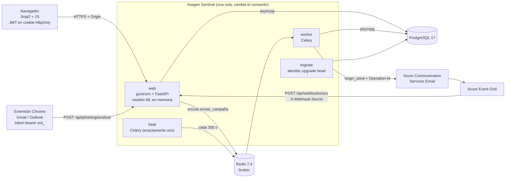
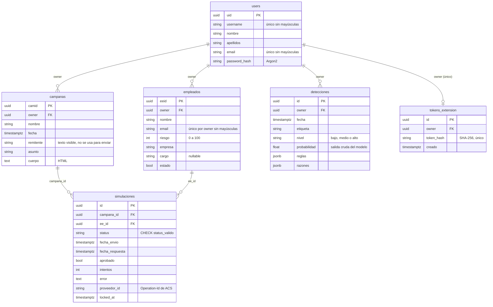
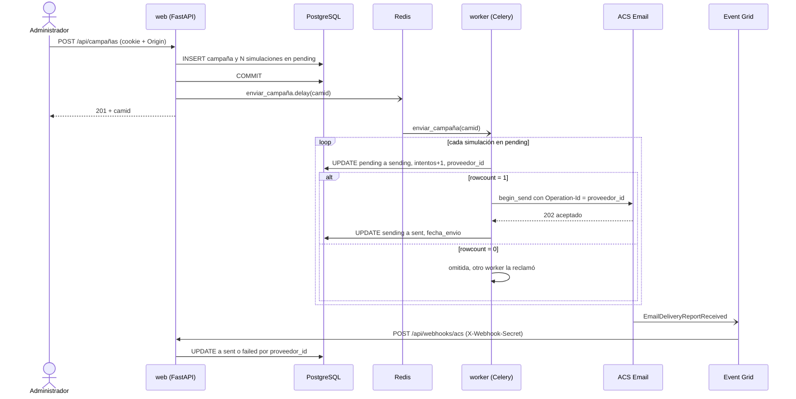
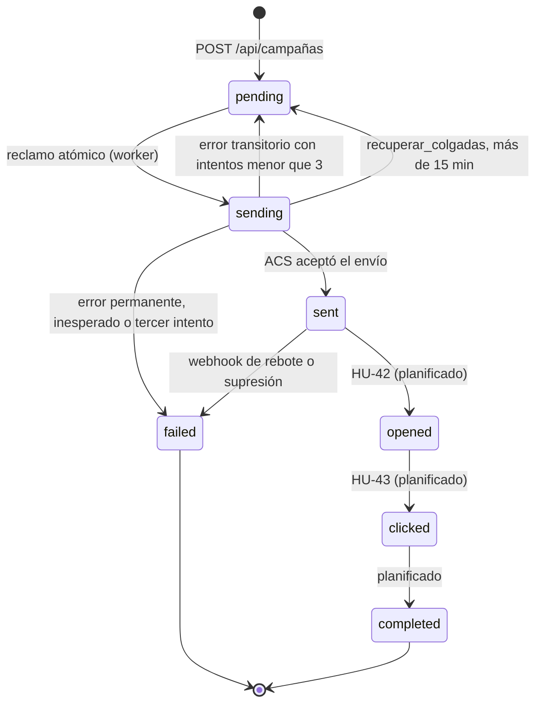
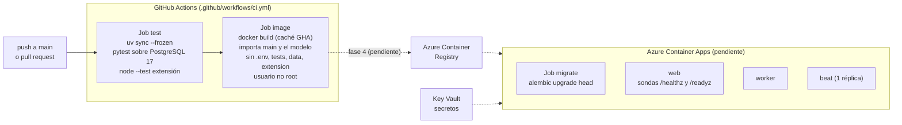
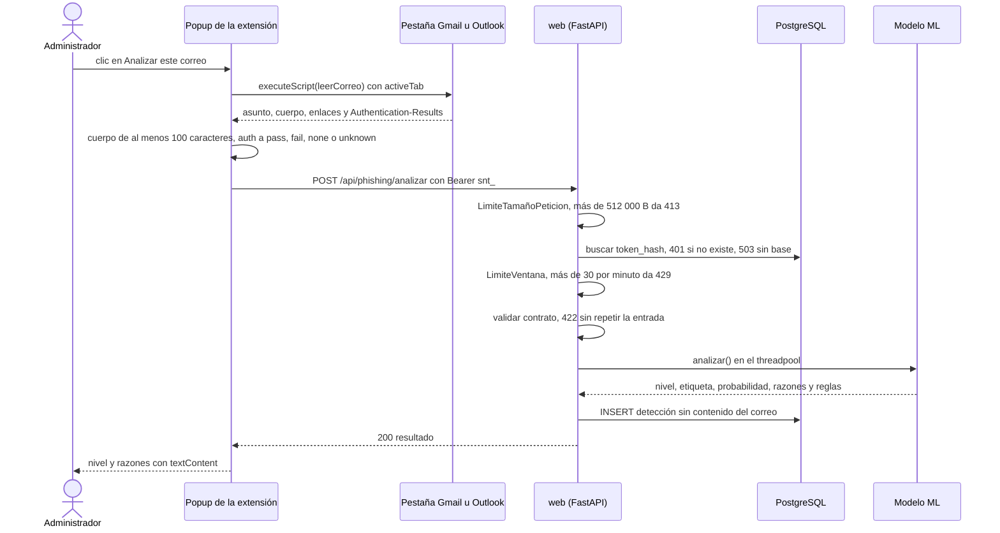

# Sentinel · Documentación técnica

**Proyecto:** Sentinel — Plataforma de simulación y detección de phishing para pymes colombianas
**Autor:** Jose Miguel Franco Zabala — ID 100097477
**Versión:** 1.0

- **Parte I · Arquitectura:** componentes, datos, flujos, despliegue, configuración, decisiones, amenazas y tratamiento de datos.
- **Parte II · Historias de usuario y criterios de aceptación:** alcance funcional verificable y su trazabilidad con el código y las pruebas.

---

# Parte I · Arquitectura

## 1. Arquitectura general

- **web** sirve las páginas (Jinja2), la API REST y el análisis de phishing. Carga el modelo al arrancar (`lifespan`). Sin un modelo válido, no arranca.
- **worker** envía los correos de las campañas. **beat** programa dos tareas cada 300 s: `barrer_pendientes` y `recuperar_colgadas`.
- **La base de datos es la fuente de verdad.** Celery no guarda resultados, y si Redis falla al crear la campaña, el barrido la recupera.
- **Modo eager** (`CELERY_TASK_ALWAYS_EAGER=true`): el envío se ejecuta dentro del proceso web, sin Redis, worker ni beat. Es el modo de demostración.
- **Dos drivers para la misma base:** asyncpg para los endpoints `async` y psycopg para el worker, los endpoints `def` (análisis) y Alembic.
- **Fronteras de confianza:**
  - Las escrituras del navegador exigen un `Origin` permitido.
  - El webhook se autentica con un secreto compartido.
  - La extensión usa un token bearer propio y nunca la cookie de sesión.

## 2. Modelo de datos

- **Claves primarias UUID4** generadas en Python: el id se conoce antes del `flush` y no revela orden ni volumen.
- **Borrado en cascada en dos niveles:** en el ORM (`cascade="all, delete-orphan"`) y en la base (`ON DELETE CASCADE`). Un `DELETE` directo en SQL tampoco deja huérfanos.
- **Unicidad sin distinguir mayúsculas** mediante índices sobre `lower()`: `uq_users_username_lower`, `uq_users_email_lower` y `uq_empleados_owner_email_lower`. `utils/validaciones.py` da el `400` con un mensaje claro, y el índice cubre las carreras entre peticiones simultáneas.
- **Las simulaciones no tienen `owner` propio:** pertenecen al dueño de su campaña.
- **`detecciones` no guarda el correo.** `razones` puede citar hasta 3 términos del texto, así que solo la ve su dueño.
- **Recurso ajeno o inexistente → `404`** en ambos casos (`core/permisos.py`). Un id que no es UUID da `422`.

## 3. Secuencia: creación y envío de una campaña

- **Se encola después del commit.** Si Redis no responde, la campaña queda creada en `pending` y `barrer_pendientes` la encola en menos de 300 s.
- **Idempotencia:**
  - El reclamo atómico impide que dos workers envíen la misma fila.
  - `proveedor_id` se fija en el primer reclamo y se reutiliza en cada reintento, de modo que ACS no crea un segundo correo (`409` → se trata como enviado).
- **Webhook:** `Delivered` → `sent`. Cualquier otro estado (rebote, supresión, cuarentena) → `failed`, con el motivo. `Expanded` y los eventos sin `messageId` se ignoran. Solo se sobrescriben filas en `sending` o `sent`.

## 4. Estados de una simulación

- **Valores por defecto:** `EMAIL_MAX_INTENTOS=3` y `EMAIL_LOCK_TIMEOUT_MINUTOS=15`.
- **Errores transitorios:** timeout, error de conexión, `429` o `5xx`. **Permanentes:** el resto de `4xx`, backend no soportado o ACS sin configurar.
- Si no se puede guardar el resultado, se reintenta 3 veces. Después, la fila queda en `sending` y `recuperar_colgadas` la libera; el reenvío usa el mismo `proveedor_id`.
- **Estados sin productor:** ningún componente produce aún `opened`, `clicked` ni `completed`, ni actualiza `aprobado` o `fecha_respuesta`. Los siete estados existen en la restricción `status_valido`, y un test verifica que coinciden con `SimulacionStatus` de la API.
- **Sustituto temporal en el dashboard:** un correo `sent` hace más de 7 días se da por terminado (`DIAS_COMPLETADA_PRUEBA`).

## 5. Despliegue

- **Una sola imagen** (`Dockerfile`), con varios comandos:
  - `gunicorn -c gunicorn.conf.py main:app` (web, por defecto)
  - `celery … worker`
  - `celery … beat`
  - `alembic upgrade head`
- **Etapas de construcción:** `uv sync --frozen --no-dev`, y el CSS se minifica con `rcssmin` (el repositorio conserva la versión legible).
- **La imagen final** corre con el usuario `app` (uid 10001), sin shell de login. El código pertenece a root, así que el proceso no puede modificarlo.
- **gunicorn:** usa `UvicornWorker`, con `WEB_CONCURRENCY` workers (2 por defecto). Cada worker carga su propio modelo (~10 MB). El `timeout` es de 60 s. `FORWARDED_ALLOW_IPS="*"` es seguro solo detrás del ingress de Container Apps.
- **Local con contenedores:** `docker compose --profile app up --build` levanta `migrate` → `web`, `worker` y `beat`, con Redis real. Siempre fuerza `EMAIL_BACKEND=log` y `AUTH_COOKIE_SECURE=false`.
- **Sondas:**
  - `/healthz`: liveness, no consulta la base.
  - `/readyz`: la base responde y su esquema coincide con la última migración de la imagen.
- **Pendiente (CA-39.3):** publicar en ACR y desplegar en Container Apps con OIDC (sin secretos guardados en GitHub), con los secretos en Key Vault.

## 6. Secuencia: análisis de un correo desde la extensión

- **Endpoint síncrono:** el endpoint es `def`, no `async def`. `analizar()` consume CPU (~3 ms en un correo normal, ~30 ms con 100 KB) y bloquearía el event loop, así que corre en el threadpool.
- **Por qué el límite de tamaño es middleware:** FastAPI lee el cuerpo antes de resolver las dependencias, así que el límite corta antes y cuenta los bytes reales recibidos, no solo `Content-Length`.
- **Modelo:**
  - TF-IDF de palabras (1–2) y caracteres (3–5) → `LogisticRegression`, entrenado con SpaPhish y SpearPhishMX.
  - F1 de 0.961 en la partición de prueba de SpaPhish.
  - Detalles y limitaciones en `ml/README.md` del repositorio principal.
- **Capa de reglas:** `dmarc=fail` y `spf=fail` suben un nivel (solo uno si fallan ambos), y `dkim=fail` suma 0.10. Un `pass` nunca baja el riesgo.
- **La extensión** solo acepta la cabecera `Authentication-Results` de `mx.google.com`. En Outlook no hay cabeceras y el análisis se basa solo en el contenido.

## 7. Configuración y operación

### 7.1. Variables de entorno

Las lee `core/config.py` (pydantic-settings). Si una variable está tanto en el entorno como en `.env`, prevalece la del entorno. Una variable obligatoria que falte impide arrancar, y los errores de validación no repiten los valores.

| Variable | Obligatoria | Por defecto | Uso |
|---|---|---|---|
| `SECRET_KEY` | Sí | — | Firma la cookie de sesión de los mensajes flash (`SessionMiddleware`) |
| `SECRET_KEY_AUTH` | Sí | — | Firma los JWT (HS256) |
| `DATABASE_URL` | Sí | — | `postgresql+asyncpg://…` para la web |
| `WORKER_DATABASE_URL` | Sí | — | `postgresql+psycopg://…` para el worker, los endpoints `def` y Alembic |
| `DB_POOL_SIZE` / `DB_MAX_OVERFLOW` | No | `5` / `5` | Pool por proceso y por motor. Conexiones máximas ≈ (POOL + OVERFLOW) × 2 motores × workers × réplicas |
| `DB_CONNECT_TIMEOUT` | No | `10` | Segundos para abrir una conexión |
| `CELERY_BROKER_URL` | Sí | — | `redis://…` (en eager basta `memory://`) |
| `CELERY_TASK_ALWAYS_EAGER` | No | `true` | `true`: el envío corre dentro de la web, sin Redis. Acepta `sí` |
| `EMAIL_BACKEND` | Sí | — | `log` (no envía) o `acs` |
| `ACS_CONNECTION_STRING` | Con `acs` | `""` | Conexión a Azure Communication Services |
| `ACS_SENDER` | Con `acs` | `""` | Remitente verificado; el único que se usa para enviar |
| `ACS_REPLY_TO` | No | `""` | Dirección de respuesta opcional |
| `ACS_WEBHOOK_SECRET` | Sí | — | Secreto de la cabecera `X-Webhook-Secret`. Vacío: el webhook rechaza todo |
| `EMAIL_MAX_INTENTOS` | No | `3` | Intentos por simulación ante errores transitorios |
| `EMAIL_LOCK_TIMEOUT_MINUTOS` | No | `15` | Antigüedad de `sending` a partir de la cual se libera la fila |
| `ALGORITHM` | No | `HS256` | Algoritmo del JWT |
| `ACCESS_TOKEN_EXPIRE_MINUTES` | No | `30` | Vigencia del JWT y de la cookie |
| `AUTH_COOKIE_NAME` | No | `access_token` | Nombre de la cookie de sesión |
| `AUTH_COOKIE_SECURE` | No | `true` | `false` solo en desarrollo por HTTP |
| `ALLOWED_ORIGINS` | Sí | — | JSON, p. ej. `'["https://app.sentinel.world"]'`. Se normaliza a minúsculas y sin `/` final |
| `ANALISIS_POR_MINUTO` | No | `30` | Análisis por usuario y por worker de gunicorn |
| `WEB_CONCURRENCY` | No | `2` | Workers de gunicorn (`gunicorn.conf.py`) |
| `PORT` | No | `8000` | Puerto de escucha |
| `FORWARDED_ALLOW_IPS` | No | `127.0.0.1` (`*` en la imagen) | Desde qué IPs se confía en `X-Forwarded-*` |
| `SEED_PASSWORD` | No | — | Contraseña de la cuenta demo (`scripts/seed.py`) |
| `TEST_POSTGRES_URL` | No | servidor de `docker-compose.yml` | Servidor donde las pruebas crean su base desechable |

> ⚠️ **Pendiente (CA-40.5):** generar `.env.example` a partir de esta tabla.

### 7.2. Alta del webhook de entrega

1. En Event Grid, crea una suscripción de eventos del recurso de ACS con el tipo `Microsoft.Communication.EmailDeliveryReportReceived`.
2. Destino: webhook a `https://<dominio>/api/webhooks/acs`.
3. En **Delivery properties**, añade la cabecera `X-Webhook-Secret` con el mismo valor que `ACS_WEBHOOK_SECRET`. Márcala como secreta.
4. Al guardar, Event Grid envía el `SubscriptionValidationEvent`. La aplicación devuelve el `validationResponse` y la suscripción queda activa (HU-31).

### 7.3. Rotación de secretos

| Secreto | Efecto de rotarlo | Procedimiento |
|---|---|---|
| `SECRET_KEY_AUTH` | Cierra todas las sesiones (los JWT duran como máximo 30 min) | Cambiar el valor y reiniciar la web |
| `SECRET_KEY` | Se pierden los mensajes flash pendientes | Cambiar el valor y reiniciar la web |
| `ACS_WEBHOOK_SECRET` | Los eventos con el valor anterior reciben `401`, y Event Grid los reintenta | Cambiar a la vez la delivery property de la suscripción y la variable |
| Token de extensión | Afecta solo a su usuario | El usuario lo revoca o lo regenera en `/cuenta` (HU-50) |
| `ACS_CONNECTION_STRING` | Los envíos fallan hasta actualizarla | Regenerar la clave en ACS, actualizar la variable y reiniciar el worker |

### 7.4. Diagnóstico

- **`/readyz` da `503` con "migraciones pendientes":** la imagen trae una migración que la base no tiene. Ejecutar el job `migrate` (`alembic upgrade head`).
- **Simulaciones atascadas en `sending`:** `recuperar_colgadas` las devuelve a `pending` pasados 15 min, y el reenvío no duplica el correo. Para revisarlas: `SELECT id, intentos, error, locked_at FROM simulaciones WHERE status = 'sending'`.
- **Campaña con filas en `pending` que no avanzan:** verificar que `beat` y `worker` están en ejecución y que hay exactamente un `beat`.
- **Análisis con `429` frecuentes:** el límite es por worker. Subir `ANALISIS_POR_MINUTO` teniendo en cuenta `WEB_CONCURRENCY`.
- **Registros:** van a stdout/stderr (Log Analytics en Container Apps). El análisis registra solo metadatos, nunca el correo.

## 8. Decisiones de arquitectura (ADR)

Cada decisión indica su contexto, lo que se decidió y sus consecuencias. Todas están **aceptadas** y vigentes en `3b3dd92`.

### ADR-01 · El JWT viaja solo en una cookie HttpOnly

- **Contexto:** un token en `localStorage` queda expuesto a cualquier XSS.
- **Decisión:** el login responde `204` y deja el JWT en la cookie `access_token` (`HttpOnly`, `SameSite=Lax`, `Secure` y 30 min). El JavaScript nunca lo ve.
- **Consecuencias:** la superficie del frontend es mínima. A cambio, hace falta protección CSRF (ADR-02), y un JWT no se puede revocar antes de que expire.

### ADR-02 · CSRF por verificación de `Origin`

- **Contexto:** `SameSite=Lax` no basta, porque los subdominios de `sentinel.world` cuentan como el mismo *site*.
- **Decisión:** todo `POST`, `PUT`, `PATCH` o `DELETE` exige un `Origin` incluido en `ALLOWED_ORIGINS`, y la ausencia de `Origin` también se rechaza. Solo hay dos excepciones: el webhook y el análisis, que se autentican sin cookie.
- **Consecuencias:** no se necesitan tokens CSRF en los formularios. Las excepciones son prefijos exactos, y hay una prueba de que no cubren rutas parecidas.

### ADR-03 · Token propio para la extensión

- **Contexto:** la extensión llama desde `chrome-extension://`, sin un `Origin` permitido. Aceptar ahí la cookie abriría CSRF.
- **Decisión:** se usa un token bearer `snt_` + 32 bytes aleatorios. Hay uno por usuario y se guarda solo su SHA-256. Se muestra una sola vez, y la ruta de análisis acepta únicamente este token.
- **Consecuencias:** robar la base no da tokens usables. El token vive sin cifrar en `chrome.storage.local`, y el usuario lo revoca desde `/cuenta`.

### ADR-04 · Identificadores UUID4

- **Contexto:** los ids enteros secuenciales revelan volumen y facilitan la enumeración.
- **Decisión:** todas las claves primarias son UUID4 generadas en Python.
- **Consecuencias:** el id se conoce antes del `flush`. Como el UUID no ordena, los listados desempatan por fecha.

### ADR-05 · Envío asíncrono e idempotente

- **Contexto:** la cola entrega al menos una vez (`acks_late`) y el worker puede morir en mitad de un envío.
- **Decisión:**
  - Cada fila se reclama con un `UPDATE … WHERE status='pending'` condicional.
  - El `proveedor_id` (Operation-Id de ACS) se fija en el primer reclamo y se reutiliza en los reintentos.
  - Dos tareas periódicas cubren los huecos: el barrido y la recuperación.
- **Consecuencias:** no hay correos duplicados ni pérdidas silenciosas. La base es la fuente de verdad y Celery no guarda resultados.

### ADR-06 · Modo eager como alternativa sin infraestructura

- **Contexto:** la demostración y el desarrollo no siempre tienen Redis.
- **Decisión:** con `CELERY_TASK_ALWAYS_EAGER=true`, la tarea corre dentro de la web y sus fallos no rompen la petición.
- **Consecuencias:** el mismo código sirve para los dos modos. En eager, el envío alarga la petición de creación.

### ADR-07 · El remitente sale de la configuración

- **Contexto:** el remitente que escribe el usuario no está verificado en ACS, y permitirlo facilitaría la suplantación.
- **Decisión:** se envía siempre desde `ACS_SENDER`. `Campaña.remitente` es solo texto descriptivo.
- **Consecuencias:** se evita la suplantación de dominios reales. Queda pendiente avisarlo en la interfaz (CA-28.3).

### ADR-08 · No se guarda el contenido de los correos analizados

- **Contexto:** los correos que analiza la extensión pueden contener datos personales y confidenciales de terceros.
- **Decisión:** se guardan la etiqueta, el nivel, la probabilidad, las reglas y las razones. El cuerpo, el asunto y las URLs no se guardan ni se registran, y las razones tampoco van al diario.
- **Consecuencias:** se minimizan los datos tratados (ver §10). A cambio, no se puede reentrenar con lo analizado ni auditar un falso positivo después.

### ADR-09 · Modelo clásico dentro del proceso web, con capa de reglas

- **Contexto:** un MVP con pocos datos en español, sin GPU, que necesita explicaciones legibles.
- **Decisión:**
  - Se usa TF-IDF + regresión logística, cargado en cada worker de gunicorn y ejecutado en el threadpool.
  - Las razones salen de los n-gramas que más aportan.
  - SPF, DKIM y DMARC se evalúan en una tabla de reglas aparte del modelo.
- **Consecuencias:** ~3 ms por análisis y ~10 MB por worker, sin un servicio adicional. El pickle exige la misma versión de scikit-learn, y la app no arranca si no coincide.

### ADR-10 · Límite de frecuencia en memoria por proceso

- **Contexto:** el análisis consume CPU, y el modo eager no tiene Redis.
- **Decisión:** se usa una ventana deslizante en memoria, con un lock, por usuario y por worker.
- **Consecuencias:** es simple y no depende de nada externo. El tope real es `ANALISIS_POR_MINUTO × workers × réplicas`, y la cuenta se reinicia con cada despliegue.

### ADR-11 · PostgreSQL con migraciones Alembic

- **Contexto:** SQLite no admite escrituras concurrentes desde la web y el worker, ni varias réplicas.
- **Decisión:** se usa PostgreSQL 17 y la app no crea tablas. El esquema solo cambia mediante migraciones revisadas, y una prueba falla si los modelos se desvían de ellas.
- **Consecuencias:** hay que ejecutar `migrate` antes de cada despliegue, y `/readyz` lo verifica.

### ADR-12 · GitHub Actions en lugar de Azure Pipelines

- **Contexto:** el código vive en GitHub, y el pipeline anterior no ejecutaba pruebas.
- **Decisión:** el CI tiene dos jobs, pruebas sobre PostgreSQL real y construcción y validación de la imagen. Solo tiene permisos de lectura.
- **Consecuencias:** cada push y cada PR quedan verificados. El despliegue a Azure llegará con OIDC (fase 4).

### ADR-13 · `404` en lugar de `403` para recursos ajenos

- **Contexto:** un `403` confirma que el recurso existe.
- **Decisión:** un recurso ajeno y uno inexistente devuelven la misma respuesta `404`.
- **Consecuencias:** no se puede enumerar recursos de otras cuentas. La unicidad del correo de los empleados es por dueño por la misma razón.

## 9. Modelo de amenazas

Análisis STRIDE por frontera de confianza (§1). Las mitigaciones citan la historia o la decisión que las fija.

| Categoría | Amenaza | Componente | Mitigación | Referencia |
|---|---|---|---|---|
| Suplantación | Robo de la sesión por XSS | Navegador | JWT solo en una cookie HttpOnly; el JS nunca lo lee | ADR-01, CA-2.3 |
| Suplantación | Enumerar usuarios por el mensaje o el tiempo de login | `/api/usuarios/token` | Mismo `401` y verificación contra un hash falso cuando el usuario no existe | CA-2.5, CA-2.6 |
| Suplantación | Eventos de entrega falsos | Webhook | Secreto compartido comparado en tiempo constante; sin secreto se rechaza todo | HU-30 |
| Suplantación | Uso de un token de extensión robado de la base | Extensión | Solo se guarda el SHA-256; el usuario puede revocarlo | ADR-03, HU-50 |
| Suplantación | Correo simulado desde un dominio real | Envío | Remitente fijo en `ACS_SENDER` | ADR-07 |
| Manipulación | CSRF desde un sitio externo o un subdominio | Escrituras de la API | `Origin` obligatorio y en la lista blanca | ADR-02, HU-36 |
| Manipulación | Cabecera `Authentication-Results` falsificada por el remitente | Extensión | Solo se acepta la de `mx.google.com`, en la parte superior | CA-48.6 |
| Manipulación | XSS almacenado vía razones, nombres o el cuerpo del correo | Páginas, popup | Escape automático de Jinja2; `textContent` en el popup; sanitización en el editor | CA-20.7, CA-51.7 |
| Repudio | Acciones sin rastro | Worker, análisis, webhook | Diario de cada envío, análisis y evento (metadatos, sin contenido) | CA-53.2 |
| Divulgación | Acceso a datos de otra cuenta | API | Filtro por `owner`, `404` uniforme, UUID4 | HU-09, ADR-04, ADR-13 |
| Divulgación | Contenido de correos en la base o en el diario | Análisis | No se guarda ni se registra; el `422` no repite la entrada | ADR-08, HU-53 |
| Divulgación | Secretos en errores o en el diario | Configuración | `SecretStr` y `hide_input_in_errors` | CA-40.7 |
| Divulgación | Página privada servida desde caché tras el logout | Navegador | `Cache-Control: no-store` en páginas y API | CA-3.4, CA-37.4 |
| Denegación de servicio | Agotar la CPU con análisis | Web | 30 análisis/min por usuario; `413` antes de leer el cuerpo | HU-52 |
| Denegación de servicio | Campaña sin enviar por una caída de Redis | Envío | Barrido periódico y recuperación de filas colgadas | HU-26, HU-27 |
| Elevación de privilegios | Contenedor comprometido modifica el código | Imagen | Usuario sin privilegios; el código pertenece a root | CA-39.7 |

**Riesgos residuales** (aceptados o pendientes):

1. **Uso indebido de la plataforma para phishing real.** Cualquiera puede registrarse y enviar correos con cuerpo libre a direcciones arbitrarias. El remitente fijo lo limita, pero no se verifica que los empleados pertenezcan a la organización del administrador. *Propuesta:* verificar el dominio de los destinatarios o exigir aprobación antes del primer envío (HU-57).
2. **Sin límite de intentos de login.** Solo el costo de Argon2 frena la fuerza bruta. *Propuesta:* aplicar `LimiteVentana` por IP y por usuario en `/api/usuarios/token` (HU-58).
3. **Sanitización del HTML solo en el cliente** (CA-20.12). Una petición directa puede guardar HTML arbitrario, que luego se envía a los destinatarios.
4. **Los JWT no se pueden revocar** antes de expirar (30 min), por ejemplo si roban la cookie. Borrar la cuenta sí los invalida, porque el usuario deja de existir.
5. **Token de extensión sin cifrar** en el perfil del navegador.
6. **Límite de análisis por proceso**, que se reinicia con cada despliegue (ADR-10).
7. **Dependencia del HTML de Gmail y Outlook**, que no es una API pública. Si cambia, la extensión deja de leer el correo, pero no envía datos erróneos.

## 10. Tratamiento de datos personales

Esta sección resume cómo trata el sistema los datos personales. Lo hace frente a la Ley 1581 de 2012 y el Decreto 1377 de 2013 (Colombia). Es una descripción técnica y no sustituye una revisión jurídica.

### 10.1. Roles

- **Responsable del tratamiento de los datos de sus empleados:** la pyme, a través de su administrador. Es quien los carga y decide las campañas.
- **Encargado:** Sentinel, como plataforma que trata esos datos por cuenta de la pyme.
- **Responsable de los datos de la cuenta del administrador:** el operador de Sentinel.

### 10.2. Inventario

| Titular | Datos | Finalidad | Dónde | Conservación |
|---|---|---|---|---|
| Administrador | Usuario, nombre, apellidos, correo, hash Argon2 de la contraseña | Autenticación y gestión de la cuenta | `users` | Hasta que borra la cuenta |
| Empleado | Nombre, correo, empresa, cargo, índice de riesgo, estado | Destinatario de las campañas y priorización de la formación | `empleados` | Hasta que se elimina el empleado o la cuenta |
| Empleado | Resultado de cada simulación (estado, fechas, intentos, error) | Medir la entrega y, en el futuro, la interacción | `simulaciones` | Igual que la campaña |
| Remitentes y destinatarios de correos analizados | Ninguno, salvo hasta 3 términos citados en `razones` | Explicar el resultado al administrador | `detecciones` | Hasta que se borra la cuenta |

### 10.3. Principios aplicados

- **Minimización:** no se guarda el contenido de los correos analizados (ADR-08). Los empleados no tienen cuenta ni credenciales.
- **Acceso restringido:** cada dato solo es visible para la cuenta que lo creó (HU-09).
- **Seguridad:** HTTPS, cookie HttpOnly, contraseñas con Argon2, tokens con hash y secretos fuera del repositorio (§9).
- **Supresión:** al borrar la cuenta se eliminan en cascada todos sus datos (HU-06). El administrador puede corregir o eliminar a cada empleado (HU-13, HU-15).

### 10.4. Pendiente

- Publicar una política de tratamiento y un aviso de privacidad, y mostrarlos en el registro.
- Instruir a la pyme sobre la autorización de sus empleados y la información que les debe dar. El índice de riesgo es un perfilamiento.
- Definir un plazo de conservación para las detecciones y las simulaciones antiguas. Hoy se conservan indefinidamente.
- Documentar la región de Azure y, si es fuera de Colombia, el régimen de transferencia internacional.
- Permitir exportar los datos de la cuenta, para el derecho de acceso.

---

# Parte II · Historias de usuario y criterios de aceptación

## 0. Convenciones

### 0.1. Roles (personas)

| Rol | Descripción |
|---|---|
| **Administrador** | Usuario registrado de la pyme. Responsable de la seguridad sin área de TI dedicada. Es el actor principal de todas las historias funcionales. |
| **Destinatario** | Empleado de la pyme que recibe el correo simulado. No tiene cuenta en la plataforma; su interacción se registra de forma indirecta. |
| **Sistema** | Componente interno (worker, webhook, middleware). Actor de las historias técnicas. |
| **Operador** | Responsable del despliegue y la configuración del entorno. |

### 0.2. Prioridades (MoSCoW)

| Código | Significado |
|---|---|
| **M** | Must — imprescindible; sin ella el flujo no se completa |
| **S** | Should — importante; afecta la calidad o la confianza en el producto |
| **C** | Could — deseable; mejora la experiencia |

### 0.3. Notación de los criterios

Los criterios usan el formato **Dado / Cuando / Entonces** (Gherkin), de modo que cada uno sea directamente convertible en una prueba automatizada. Cuando el criterio **no se cumple** en el código actual, se marca con `⚠️` y se indica la desviación concreta y su ubicación.

Códigos HTTP usados: `200` lectura correcta · `201` creación · `204` éxito sin cuerpo · `303` redirección tras formulario · `400` regla de negocio incumplida · `401` sin sesión o credenciales inválidas · `403` origen no permitido · `404` recurso inexistente o ajeno · `409` conflicto de estado · `413` petición demasiado grande · `422` datos que no superan la validación del esquema · `429` demasiadas peticiones · `503` dependencia no disponible.

Los identificadores (`uid`, `eeid`, `camid` y el resto) son UUID4.

### 0.4. Índice

| Épica | Historias | Prioridad dominante |
|---|---|---|
| EP-01 Cuentas y sesión | HU-01 … HU-09 | M |
| EP-02 Plantilla de empleados | HU-10 … HU-17 | M |
| EP-03 Constructor de campañas | HU-18 … HU-23 | M |
| EP-04 Motor de envío | HU-24 … HU-28 | M |
| EP-05 Confirmación de entrega | HU-29 … HU-31 | S |
| EP-06 Monitoreo | HU-32 … HU-35, HU-49 | S |
| EP-07 Seguridad y plataforma | HU-36 … HU-40, HU-54 … HU-56 | S |
| EP-08 Detección de phishing | HU-47, HU-48, HU-50 … HU-53 | M |

Los IDs se mantienen estables entre versiones: las historias que estaban planificadas (Anexo C) conservan su número al implementarse.

---

# EP-01 · Cuentas y sesión

## HU-01 · Registro de cuenta

**Como** administrador de una pyme **quiero** crear una cuenta con mis datos **para** empezar a usar la plataforma sin depender de un proveedor externo.

**Prioridad:** M · **Endpoint:** `POST /api/usuarios` · **Pantalla:** `/registro` · **Archivos:** `routers/usuarios.py`, `schemas/usuarios.py`, `utils/validaciones.py`

**Criterios de aceptación**

- **CA-1.1** Dado que completo usuario, nombre, apellidos, correo y una contraseña de al menos 15 caracteres, cuando envío el formulario, entonces el sistema responde `201` y devuelve `uid` (UUID4), `username`, `nombre`, `apellidos` y `email`, sin ningún campo de contraseña ni de hash.
- **CA-1.2** Dado que el nombre de usuario ya existe en otra cuenta —sin distinguir mayúsculas de minúsculas—, cuando me registro, entonces recibo `400` con el mensaje *"El usuario con username {username} ya existe."*
- **CA-1.3** Dado que el correo ya está registrado en otra cuenta, cuando me registro, entonces recibo `400` con el mensaje *"Ya existe un usuario con email {email}"*.
- **CA-1.4** Dado que introduzco una contraseña de 14 caracteres o menos, cuando envío el formulario, entonces recibo `422` y la cuenta no se crea.
- **CA-1.5** Dado que introduzco un correo con formato inválido, cuando envío el formulario, entonces recibo `422` y la cuenta no se crea.
- **CA-1.6** Dado que el nombre de usuario supera 50 caracteres o el nombre o los apellidos están vacíos, cuando envío el formulario, entonces recibo `422`.
- **CA-1.7** Dado un registro válido, cuando consulto la base de datos, entonces el correo está almacenado en minúsculas y la contraseña figura como hash Argon2, nunca en texto plano.
- **CA-1.8** Dado que envío el registro desde un origen no incluido en la lista blanca, cuando la petición llega, entonces recibo `403` con el mensaje *"Origen de la solicitud no permitido."*
- **CA-1.9** Dado que ya tengo una sesión activa, cuando visito `/registro`, entonces soy redirigido con `303` a `/dashboard`.

---

## HU-02 · Inicio de sesión

**Como** administrador **quiero** autenticarme con mi usuario y contraseña **para** acceder a mis campañas y empleados de forma segura.

**Prioridad:** M · **Endpoint:** `POST /api/usuarios/token` · **Pantalla:** `/login` · **Archivos:** `core/auth.py`, `routers/usuarios.py`

**Criterios de aceptación**

- **CA-2.1** Dado que introduzco credenciales correctas, cuando envío el formulario, entonces el sistema responde `204` sin cuerpo y establece la cookie `access_token`.
- **CA-2.2** Dado un inicio de sesión correcto, cuando inspecciono la cookie, entonces verifica `HttpOnly`, `SameSite=Lax`, `Path=/`, `Max-Age=1800` y `Secure` conforme a la configuración del entorno.
- **CA-2.3** Dado un inicio de sesión correcto, cuando inspecciono el cuerpo y el JavaScript de la página, entonces el token JWT no aparece en ninguno de los dos.
- **CA-2.4** Dado que introduzco una contraseña incorrecta, cuando envío el formulario, entonces recibo `401` con el mensaje *"No se pudieron validar las credenciales."*
- **CA-2.5** Dado que introduzco un nombre de usuario inexistente, cuando envío el formulario, entonces recibo el mismo `401` y el mismo mensaje que en CA-2.4.
- **CA-2.6** Dado un usuario inexistente y una contraseña incorrecta, cuando comparo los tiempos de respuesta de ambas peticiones, entonces la diferencia no permite distinguir si el usuario existe.
- **CA-2.7** Dado que escribo mi nombre de usuario con mayúsculas distintas a las registradas, cuando inicio sesión, entonces el acceso es correcto.
- **CA-2.8** Dado que ya tengo una sesión activa, cuando visito `/login`, entonces soy redirigido con `303` a `/dashboard`.

---

## HU-03 · Cierre de sesión

**Como** administrador **quiero** cerrar mi sesión **para** dejar de exponer mi cuenta en un equipo compartido.

**Prioridad:** M · **Endpoint:** `POST /api/usuarios/logout` · **Archivos:** `core/auth.py`, `routers/usuarios.py`, `static/js/auth.js`

**Criterios de aceptación**

- **CA-3.1** Dado que tengo sesión iniciada, cuando pulso "Cerrar sesión", entonces el sistema responde `204` y elimina la cookie del navegador.
- **CA-3.2** Dado que mi token ya expiró, cuando pulso "Cerrar sesión", entonces la petición se acepta igualmente con `204` y la cookie se elimina.
- **CA-3.3** Dado que cerré sesión, cuando intento acceder a `/dashboard`, entonces soy redirigido con `303` a `/login`.
- **CA-3.4** Dado que cerré sesión, cuando pulso el botón "Atrás" del navegador, entonces el navegador vuelve a solicitar la página al servidor y este redirige a `/login`; no se muestra contenido en caché.
- **CA-3.5** Dado que la petición de cierre falla por un error de red, cuando el navegador no recibe confirmación, entonces la interfaz muestra un aviso de error y **no** simula un cierre exitoso ni redirige.

---

## HU-04 · Consultar mi perfil

**Como** administrador **quiero** ver los datos de mi cuenta **para** verificar que son correctos.

**Prioridad:** M · **Endpoint:** `GET /api/usuarios/me` · **Pantalla:** `/cuenta`

**Criterios de aceptación**

- **CA-4.1** Dado que tengo sesión activa, cuando consulto mi perfil, entonces recibo `200` con `uid`, `username`, `nombre`, `apellidos` y `email`.
- **CA-4.2** Dado que no tengo sesión, cuando consulto mi perfil, entonces recibo `401` con el mensaje *"Token invalido o expirado."*
- **CA-4.3** Dado que envío un token con firma manipulada, cuando consulto mi perfil, entonces recibo `401`.

---

## HU-05 · Actualizar mi perfil

**Como** administrador **quiero** modificar mi nombre, usuario o correo **para** mantener mis datos actualizados.

**Prioridad:** S · **Endpoint:** `PATCH /api/usuarios/{uid}` · **Pantalla:** `/cuenta` · **Archivos:** `routers/usuarios.py`, `templates/cuenta.html`

**Criterios de aceptación**

- **CA-5.1** Dado que modifico únicamente el nombre, cuando guardo, entonces recibo `200` y solo ese campo cambia; usuario, apellidos y correo conservan su valor.
- **CA-5.2** Dado que no modifico ningún campo, cuando pulso guardar, entonces recibo `400` con el mensaje *"No se detecto ningun cambio en los datos del usuario."*
- **CA-5.3** Dado que cambio mi nombre de usuario por uno ya ocupado, cuando guardo, entonces recibo `400` con el mensaje de duplicidad y ningún campo se modifica.
- **CA-5.4** Dado que cambio mi correo por uno ya registrado, cuando guardo, entonces recibo `400` y ningún campo se modifica.
- **CA-5.5** Dado que cambio mi correo escribiéndolo en mayúsculas, cuando guardo, entonces se almacena en minúsculas.
- **CA-5.6** Dado que intento modificar el perfil de otro usuario, cuando envío la petición, entonces recibo `404`.
- **CA-5.7** Dado que guardo cambios correctamente, cuando la interfaz recibe la respuesta, entonces los nuevos valores pasan a ser la referencia para detectar cambios posteriores.

---

## HU-06 · Eliminar mi cuenta

**Como** administrador **quiero** eliminar mi cuenta y todos mis datos **para** ejercer mi derecho de supresión.

**Prioridad:** S · **Endpoint:** `DELETE /api/usuarios/{uid}` · **Pantalla:** `/cuenta` · **Archivos:** `routers/usuarios.py`, `models/__init__.py`, `templates/cuenta.html`

**Criterios de aceptación**

- **CA-6.1** Dado que estoy en la pantalla de cuenta, cuando abro el diálogo de eliminación, entonces veo el número exacto de campañas, empleados, simulaciones y detecciones que se van a destruir.
- **CA-6.2** Dado que el diálogo está abierto, cuando el texto escrito no coincide exactamente con mi nombre de usuario, entonces el botón de confirmación permanece deshabilitado.
- **CA-6.3** Dado que confirmo la eliminación, cuando la petición se procesa, entonces recibo `204`, la cuenta se elimina y la cookie de sesión se borra.
- **CA-6.4** Dado que confirmo la eliminación, cuando consulto la base de datos, entonces no queda ninguna campaña, empleado, simulación, detección ni token de extensión asociado a mi cuenta. El borrado en cascada se aplica también en la base de datos (`ON DELETE CASCADE`), no solo en el ORM.
- **CA-6.5** Dado que intento eliminar la cuenta de otro usuario, cuando envío la petición, entonces recibo `404`.

---

## HU-07 · Cambiar el tema visual

**Como** administrador **quiero** alternar entre tema claro y oscuro **para** trabajar cómodamente según la iluminación.

**Prioridad:** C · **Endpoint:** `POST /cuenta/tema` · **Archivos:** `main.py`, `templates/layout.html`

**Criterios de aceptación**

- **CA-7.1** Dado que selecciono el tema oscuro, cuando se procesa el formulario, entonces recibo `303` hacia `/cuenta` y se establece la cookie `tema` con valor `dark` y vigencia de un año.
- **CA-7.2** Dado que recargo cualquier página con el tema oscuro guardado, entonces el HTML se entrega con `data-theme="dark"` y no se observa un destello del tema claro durante la carga.
- **CA-7.3** Dado que envío un valor distinto de `light` o `dark`, cuando se procesa el formulario, entonces recibo `422`.
- **CA-7.4** Dado que no tengo la cookie de tema, cuando abro cualquier página, entonces la interfaz se presenta en tema claro.

---

## HU-08 · Protección de rutas privadas

**Como** administrador **quiero** que nadie sin sesión pueda ver mis datos **para** proteger la información de mi organización.

**Prioridad:** M · **Archivos:** `main.py`, `core/auth.py`

**Criterios de aceptación**

- **CA-8.1** Dado que no tengo sesión, cuando solicito `/dashboard`, `/empleados`, `/campañas`, `/simulacion`, `/deteccion` o `/cuenta`, entonces soy redirigido con `303` a `/login`.
- **CA-8.2** Dado que no tengo sesión, cuando solicito cualquier ruta bajo `/api/` que requiera autenticación, entonces recibo `401` con cuerpo JSON y no una redirección.
- **CA-8.3** Dado que mi token expiró, cuando solicito una página HTML, entonces soy redirigido a `/login`; cuando solicito una ruta de API, entonces recibo `401`.
- **CA-8.4** Dado que accedo a `/`, `/login` o `/registro` sin sesión, entonces las páginas se sirven con normalidad.

---

## HU-09 · Aislamiento de datos entre cuentas

**Como** administrador **quiero** que mis empleados y campañas sean invisibles para otras cuentas **para** garantizar la confidencialidad entre organizaciones.

**Prioridad:** M · **Archivos:** `core/permisos.py`, `routers/*.py`

**Criterios de aceptación**

- **CA-9.1** Dado un empleado que pertenece a otra cuenta, cuando lo solicito por su identificador, entonces recibo `404` y **no** `403`.
- **CA-9.2** Dado un identificador de campaña inexistente, cuando lo solicito, entonces recibo `404` con exactamente la misma respuesta que en CA-9.1, de modo que no se pueda deducir si el recurso existe.
- **CA-9.3** Dado que listo empleados, campañas o simulaciones, entonces la respuesta contiene únicamente registros cuyo propietario es mi cuenta.
- **CA-9.4** Dado que intento eliminar o modificar un recurso de otra cuenta, cuando envío la petición, entonces recibo `404` y el recurso permanece intacto.
- **CA-9.5** Dado que dos cuentas registran al mismo correo como empleado, entonces ambas operaciones se aceptan, porque la unicidad del correo es por propietario y no global.
- **CA-9.6** Dado cualquier recurso creado, entonces su identificador es un UUID4 generado al azar, de modo que no se puede deducir el identificador de otro recurso ni el volumen de datos de la plataforma.
- **CA-9.7** Dado que listo detecciones en `/deteccion` o en el dashboard, entonces solo aparecen las de mi cuenta.

---

# EP-02 · Plantilla de empleados

## HU-10 · Registrar empleado

**Como** administrador **quiero** dar de alta a los empleados de mi empresa **para** poder incluirlos como destinatarios de las campañas.

**Prioridad:** M · **Endpoint:** `POST /api/empleados` · **Pantalla:** `/empleados` · **Archivos:** `routers/empleados.py`, `schemas/empleados.py`, `utils/validaciones.py`

**Criterios de aceptación**

- **CA-10.1** Dado que completo nombre, correo, empresa y cargo, cuando guardo, entonces recibo `201` con el empleado creado y su identificador.
- **CA-10.2** Dado que no indico el índice de riesgo, cuando se crea el empleado, entonces se asigna `100` por defecto.
- **CA-10.3** Dado que no indico el estado, cuando se crea el empleado, entonces se marca como activo.
- **CA-10.4** Dado que indico un índice de riesgo menor que 0 o mayor que 100, cuando guardo, entonces recibo `422`.
- **CA-10.5** Dado que indico un correo con formato inválido, cuando guardo, entonces recibo `422`.
- **CA-10.6** Dado que el correo ya existe en mi plantilla —sin distinguir mayúsculas—, cuando guardo, entonces recibo `400` con el mensaje *"Ya existe un empleado con email {email}"*.
- **CA-10.7** Dado que dejo vacía la empresa, cuando guardo, entonces recibo `422`.
- **CA-10.8** Dado que el cargo se omite, cuando guardo, entonces el empleado se crea con el cargo vacío.
  > ⚠️ **Desviación actual:** en `EmpleadoBase` (`schemas/empleados.py`), `cargo: str | None = Field(max_length=50)` no tiene valor por defecto, así que el campo es obligatorio: omitirlo da `422`. Solo se acepta enviando `"cargo": null` de forma explícita. Este criterio **falla** hoy.

---

## HU-11 · Listar la plantilla de empleados

**Como** administrador **quiero** ver todos mis empleados ordenados por nivel de riesgo **para** identificar a quién debo priorizar en la formación.

**Prioridad:** M · **Endpoint:** `GET /api/empleados` · **Pantalla:** `/empleados`

**Criterios de aceptación**

- **CA-11.1** Dado que tengo empleados registrados, cuando consulto el listado, entonces recibo `200` con todos mis empleados ordenados por índice de riesgo de mayor a menor.
- **CA-11.2** Dado que existen empleados de otras cuentas, cuando consulto el listado, entonces ninguno aparece en la respuesta.
- **CA-11.3** Dado que un empleado tiene simulaciones asociadas, cuando consulto el listado, entonces la respuesta las incluye sin generar una consulta adicional por empleado.
- **CA-11.4** Dado que consulto el listado, entonces cada elemento expone su índice de riesgo y su estado.
  > ⚠️ **Desviación actual:** `EmpleadoResponse` (`schemas/empleados.py`) hereda de `EmpleadoBase`, que no incluye `riesgo` ni `estado`. La API no los devuelve, aunque la vista HTML sí los muestra porque se renderiza desde el ORM en `main.py`. Este criterio **falla** hoy.

---

## HU-12 · Consultar un empleado

**Como** administrador **quiero** ver el detalle de un empleado **para** revisar sus datos antes de editarlo.

**Prioridad:** S · **Endpoint:** `GET /api/empleados/{eeid}`

**Criterios de aceptación**

- **CA-12.1** Dado un empleado propio, cuando lo consulto, entonces recibo `200` con sus datos.
- **CA-12.2** Dado un identificador inexistente, cuando lo consulto, entonces recibo `404`.
- **CA-12.3** Dado un empleado de otra cuenta, cuando lo consulto, entonces recibo `404`.

---

## HU-13 · Editar empleado

**Como** administrador **quiero** actualizar los datos de un empleado **para** corregir información o ajustar su nivel de riesgo.

**Prioridad:** M · **Endpoint:** `PATCH /api/empleados/{eeid}` · **Pantalla:** `/empleados`

**Criterios de aceptación**

- **CA-13.1** Dado que modifico solo el cargo, cuando guardo, entonces recibo `200` y únicamente el cargo cambia.
- **CA-13.2** Dado que no envío ningún campo, cuando guardo, entonces recibo `400` con el mensaje *"No se proporcionaron cambios para actualizar el empleado."*
- **CA-13.3** Dado que cambio el correo por uno ya usado por otro empleado de mi cuenta, cuando guardo, entonces recibo `400`.
- **CA-13.4** Dado que cambio el correo por el mismo que ya tenía, cuando guardo, entonces la operación se acepta y no se reporta duplicidad.
- **CA-13.5** Dado que modifico el índice de riesgo, cuando guardo, entonces el nuevo valor se persiste.
  > ⚠️ **Desviación actual:** `EmpleadoUpdate` no declara el campo `riesgo`, por lo que el valor se descarta silenciosamente y el riesgo no cambia. Este criterio **falla** hoy.

---

## HU-14 · Reemplazar empleado

**Como** administrador **quiero** reemplazar todos los datos de un empleado en una sola operación **para** corregir registros inconsistentes.

**Prioridad:** C · **Endpoint:** `PUT /api/empleados/{eeid}`

**Criterios de aceptación**

- **CA-14.1** Dado que envío todos los campos, cuando guardo, entonces recibo `200` y el registro se reemplaza por completo.
- **CA-14.2** Dado que envío un correo duplicado de otro empleado de mi cuenta, cuando guardo, entonces recibo `400`.
- **CA-14.3** Dado que envío el cargo como `null`, cuando guardo, entonces el cargo queda almacenado como `NULL` y la respuesta lo devuelve como `null`, no como el texto `"None"`.

---

## HU-15 · Eliminar empleado

**Como** administrador **quiero** dar de baja a un empleado **para** que no reciba más campañas.

**Prioridad:** M · **Endpoint:** `DELETE /api/empleados/{eeid}`

**Criterios de aceptación**

- **CA-15.1** Dado un empleado propio, cuando lo elimino, entonces recibo `204`.
- **CA-15.2** Dado un empleado con simulaciones asociadas, cuando lo elimino, entonces sus simulaciones se eliminan en cascada y las campañas permanecen.
- **CA-15.4** Dado un identificador que no es un UUID válido, cuando intento eliminarlo, entonces recibo `422`.
- **CA-15.3** Dado un empleado de otra cuenta, cuando intento eliminarlo, entonces recibo `404` y el empleado permanece.

---

## HU-16 · Activar y desactivar empleado

**Como** administrador **quiero** suspender temporalmente a un empleado **para** excluirlo de las campañas sin perder su historial.

**Prioridad:** S · **Endpoint:** `PATCH /api/empleados/{eeid}` · **Pantalla:** `/empleados`

**Criterios de aceptación**

- **CA-16.1** Dado un empleado activo, cuando pulso el control de estado, entonces se envía `PATCH` con `estado: false` y recibo `200`.
- **CA-16.2** Dado un empleado inactivo, cuando pulso el control de estado, entonces el nuevo valor es `true` y recibo `200`.
- **CA-16.3** Dado un empleado inactivo, cuando abro el asistente de creación de campaña, entonces no aparece en la lista de destinatarios seleccionables.
- **CA-16.4** Dado un empleado inactivo, cuando intento usarlo como destinatario enviando la petición directamente, entonces recibo `400`.
- **CA-16.5** Dado que la operación falla, entonces el botón se reactiva y se muestra el mensaje de error; no queda bloqueado.

---

## HU-17 · Panel resumen de empleados

**Como** administrador **quiero** ver indicadores agregados de mi plantilla **para** dimensionar el riesgo de mi organización de un vistazo.

**Prioridad:** S · **Pantalla:** `/empleados` · **Archivos:** `main.py`, `templates/empleados.html`

**Criterios de aceptación**

- **CA-17.1** Dado que tengo empleados, cuando abro la pantalla, entonces veo cuatro indicadores: total, riesgo alto, activos e inactivos.
- **CA-17.2** Dado que un empleado tiene índice de riesgo mayor o igual a 70, entonces se cuenta en el indicador de riesgo alto.
- **CA-17.3** Dado que todos los indicadores son visibles, entonces sus valores se calculan a partir de los datos de mi cuenta y no de valores fijos.
- **CA-17.4** Dado que escribo "perez" en el buscador, cuando existe un empleado llamado "Pérez", entonces aparece en los resultados; la búsqueda ignora tildes y mayúsculas.
- **CA-17.5** Dado que la plantilla supera el tamaño de página, entonces la tabla pagina los resultados.

---

# EP-03 · Constructor de campañas

## HU-18 · Crear una campaña de phishing simulado

**Como** administrador **quiero** crear una campaña eligiendo nombre, destinatarios y contenido **para** ejecutar un simulacro formativo en mi empresa.

**Prioridad:** M · **Endpoint:** `POST /api/campañas` · **Pantalla:** `/simulacion` · **Archivos:** `routers/campañas.py`, `schemas/campañas.py`, `templates/simulacion.html`

**Criterios de aceptación**

- **CA-18.1** Dado que completo los tres pasos del asistente, cuando confirmo, entonces recibo `201` con el identificador de la campaña creada.
- **CA-18.2** Dado que la campaña se crea con N destinatarios, cuando consulto sus simulaciones, entonces existen exactamente N registros en estado `pending`, uno por destinatario.
- **CA-18.3** Dado que la campaña se crea correctamente, cuando finaliza la operación, entonces se ha encolado la tarea de envío y los correos no se envían dentro de la petición HTTP.
- **CA-18.4** Dado que no selecciono ningún destinatario, cuando confirmo, entonces recibo `400` con el mensaje *"Simulacion invalida. Ningun empleado ha sido seleccionado."*
- **CA-18.5** Dado que envío el identificador de un empleado inactivo o de otra cuenta, cuando confirmo, entonces recibo `400` con el mensaje *"Uno o mas destinatarios no existen o estan inactivos."* y la campaña no se crea.
- **CA-18.6** Dado que el arreglo de destinatarios contiene identificadores repetidos, cuando confirmo, entonces se deduplican y se crea un solo registro por empleado.
- **CA-18.7** Dado que el remitente no tiene formato de correo válido, cuando confirmo, entonces recibo `422`.
- **CA-18.8** Dado que el nombre de la campaña excede 100 caracteres, cuando confirmo, entonces recibo `422`.
- **CA-18.9** Dado que el encolado del envío falla, cuando la campaña ya fue guardada, entonces la campaña permanece creada con sus simulaciones en `pending` y el error se registra en el diario sin propagarse al usuario.
- **CA-18.10** Dado que una campaña no se puede editar, cuando necesito corregirla, entonces debo eliminarla y crearla de nuevo.
  > ⚠️ **Carencia actual:** no existe `PUT` ni `PATCH /api/campañas/{camid}`.

---

## HU-19 · Seleccionar destinatarios con búsqueda

**Como** administrador **quiero** filtrar y seleccionar empleados en el paso 2 **para** elegir el público de la campaña sin recorrer toda la plantilla.

**Prioridad:** M · **Pantalla:** `/simulacion` (paso 2) · **Archivo:** `templates/simulacion.html`

**Criterios de aceptación**

- **CA-19.1** Dado que escribo un fragmento del nombre o del correo, cuando escribo, entonces la lista se filtra en tiempo real a los empleados coincidentes.
- **CA-19.2** Dado que escribo "perez", cuando existe "Pérez", entonces el empleado aparece; la comparación ignora tildes y mayúsculas.
- **CA-19.3** Dado que marco o desmarco empleados, entonces el contador muestra "*N* de *M* seleccionados" y la fila seleccionada se resalta visualmente.
- **CA-19.4** Dado que no he seleccionado a nadie, cuando pulso "Siguiente", entonces el asistente no avanza y muestra el mensaje *"Selecciona al menos un empleado como destinatario."*
- **CA-19.5** Dado que selecciono al menos uno, entonces el mensaje de error desaparece y puedo avanzar.
- **CA-19.6** Dado que la plantilla contiene empleados inactivos, entonces no aparecen en esta lista.

---

## HU-20 · Componer el cuerpo del correo simulado

**Como** administrador **quiero** redactar el correo con formato e imágenes **para** que el simulacro sea realista y formativo.

**Prioridad:** M · **Pantalla:** `/simulacion` (paso 3) · **Archivo:** `static/js/rich-text-editor.js`

**Criterios de aceptación**

- **CA-20.1** Dado que selecciono texto y aplico negrita, cursiva, subrayado, tachado o alineación, cuando compruebo el contenido, entonces el formato se ha aplicado.
- **CA-20.2** Dado que inserto una lista ordenada o desordenada, entonces se refleja en el cuerpo del mensaje.
- **CA-20.3** Dado que inserto un enlace con URL y texto, entonces el texto visible aparece como enlace al destino indicado.
- **CA-20.4** Dado que inserto una imagen por URL, entonces se previsualiza en el editor y se incluye en el cuerpo enviado.
- **CA-20.5** Dado que selecciono un archivo de imagen de hasta 1 MB en formato PNG, JPG, GIF o WebP, entonces se inserta incrustada.
- **CA-20.6** Dado que selecciono una imagen de más de 1 MB, cuando la elijo, entonces recibo el aviso *"La imagen supera 1 MB…"* y no se inserta.
- **CA-20.7** Dado que pego contenido con etiquetas `script`, `iframe`, `object`, `embed`, `form`, `svg` o `math`, cuando el contenido sale del editor, entonces esas etiquetas han sido eliminadas.
- **CA-20.8** Dado que introduzco una URL con esquema `javascript:`, cuando el contenido sale del editor, entonces el atributo se elimina.
- **CA-20.9** Dado que introduzco una imagen con URL de datos en formato SVG, entonces se rechaza; solo se admiten formatos de trama.
- **CA-20.10** Dado que el cuerpo está vacío, cuando intento crear la campaña, entonces no se permite y se muestra *"Falta completar … el cuerpo del correo."*
- **CA-20.11** Dado que activo la vista de código fuente, entonces puedo editar el HTML y el contenido se sincroniza con el editor.
- **CA-20.12** Dado que el HTML del cuerpo llega al servidor, entonces este lo valida antes de almacenarlo.
  > ⚠️ **Carencia actual:** la sanitización existe solo en el cliente; `POST /api/campañas` almacena el HTML tal como llega.

---

## HU-21 · Usar plantillas de campaña precargadas

**Como** administrador sin experiencia en redacción de correos **quiero** partir de una plantilla **para** crear una campaña creíble en pocos pasos.

**Prioridad:** S · **Pantalla:** `/simulacion` (paso 3) · **Archivo:** `templates/simulacion.html`

**Criterios de aceptación**

- **CA-21.1** Dado que abro el paso 3, entonces veo cinco plantillas: verificación de cuenta, factura pendiente, buzón lleno, premio y caducidad de contraseña.
- **CA-21.2** Dado que selecciono una plantilla, entonces se rellenan automáticamente remitente, asunto y cuerpo.
- **CA-21.3** Dado que aplico una plantilla y luego edito el cuerpo, entonces la plantilla deja de considerarse seleccionada y el contenido editado es el que se envía.
- **CA-21.4** Dado que uso una plantilla, entonces su remitente pertenece a un dominio ficticio y no suplanta la identidad de una marca real.

---

## HU-22 · Enviar una campaña

**Como** administrador **quiero** activar el envío de una campaña **para** que los correos lleguen a los destinatarios en el momento que decido.

**Prioridad:** M · **Endpoint:** `POST /api/campañas/{camid}/enviar` · **Pantalla:** `/campañas` · **Archivos:** `routers/campañas.py`, `worker/tasks.py`

**Criterios de aceptación**

- **CA-22.1** Dado que la campaña tiene simulaciones en estado `pending`, cuando pulso "Activar y enviar", entonces recibo `200` con el identificador de la campaña, el número de pendientes y la confirmación de encolado.
- **CA-22.2** Dado que la campaña no tiene simulaciones pendientes, cuando pulso el botón, entonces recibo `409` con el mensaje *"La campaña no tiene simulaciones pendientes por enviar."*
- **CA-22.3** Dado que la campaña no tiene pendientes, entonces el botón aparece deshabilitado con el texto "Sin pendientes".
- **CA-22.4** Dado que la campaña tiene pendientes, entonces el botón muestra el número: "Activar y enviar (N)".
- **CA-22.5** Dado que el intermediario de mensajería no responde, cuando pulso el botón, entonces recibo `503` con *"No se pudo encolar el envío. Intenta nuevamente."*
- **CA-22.6** Dado que el encolado se realiza correctamente, entonces la interfaz muestra la confirmación y recarga la página para reflejar los nuevos estados.
- **CA-22.7** Dado que la campaña pertenece a otra cuenta, cuando solicito el envío, entonces recibo `404`.

---

## HU-23 · Eliminar una campaña

**Como** administrador **quiero** eliminar una campaña **para** limpiar simulacros obsoletos o mal configurados.

**Prioridad:** M · **Endpoint:** `DELETE /api/campañas/{camid}` · **Pantalla:** `/campañas`

**Criterios de aceptación**

- **CA-23.1** Dado que pulso eliminar, entonces se abre un diálogo que muestra el nombre de la campaña y su número de destinatarios.
- **CA-23.2** Dado que confirmo, cuando la petición se procesa, entonces recibo `204` y la campaña desaparece de la lista.
- **CA-23.3** Dado que confirmo la eliminación, entonces todas las simulaciones asociadas se eliminan en cascada y los empleados permanecen.
- **CA-23.4** Dado que la petición falla, entonces el mensaje de error se muestra dentro del diálogo y este permanece abierto.
- **CA-23.5** Dado que la campaña pertenece a otra cuenta, cuando intento eliminarla, entonces recibo `404`.

---

# EP-04 · Motor de envío

## HU-24 · Envío sin correos duplicados

**Como** administrador **quiero** que cada destinatario reciba el correo exactamente una vez **para** que el simulacro sea creíble y las métricas sean válidas.

**Prioridad:** M · **Archivo:** `worker/tasks.py` · **Componente:** `enviar_campaña`

**Criterios de aceptación**

- **CA-24.1** Dado que la tarea de envío de una campaña se ejecuta dos veces seguidas, cuando finaliza la segunda, entonces cada destinatario ha recibido exactamente un correo.
- **CA-24.2** Dado que dos procesos de envío procesan la misma campaña simultáneamente, cuando ambos terminan, entonces cada fila ha sido reclamada por uno solo y el otro la reporta como omitida.
- **CA-24.3** Dado que una fila ya fue reclamada, cuando otro proceso intenta reclamarla, entonces la actualización condicional no afecta ninguna fila y el proceso no la envía.
- **CA-24.4** Dado que una fila se reintenta, entonces el identificador de operación enviada al proveedor es el mismo que en el intento anterior.
- **CA-24.5** Dado que el proveedor informa que la operación ya existía porque un intento anterior sí llegó, entonces la fila se marca como enviada y no se genera un segundo correo.
- **CA-24.6** Dado un envío correcto, cuando consulto la fila, entonces su estado es `sent`, tiene fecha de envío y no tiene error asociado.

---

## HU-25 · Reintentos con clasificación de errores

**Como** administrador **quiero** que los fallos temporales se reintenten solos y los definitivos se reporten **para** no perder envíos recuperables ni insistir en los imposibles.

**Prioridad:** M · **Archivos:** `worker/tasks.py`, `services/email.py`

**Criterios de aceptación**

- **CA-25.1** Dado un error de tiempo de espera agotado, límite de tasa (429) o error del servidor (5xx), cuando se produce, entonces la fila vuelve a `pending`, conserva el motivo en el campo de error y queda disponible para el barrido.
- **CA-25.2** Dado un destinatario suprimido, una dirección inválida o un rechazo del proveedor, cuando se produce, entonces la fila pasa a `failed` de inmediato y no se reintenta.
- **CA-25.3** Dado que una fila acumula tres intentos fallidos por error transitorio, cuando se produce el cuarto, entonces pasa a `failed` con el motivo del último error.
- **CA-25.4** Dado un error inesperado no clasificado, cuando se produce, entonces la fila pasa a `failed` con el mensaje *"Error inesperado: …"* y no se reintenta indefinidamente.
- **CA-25.5** Dado que el resultado no se puede guardar por bloqueo de la base de datos, entonces el sistema reintenta la escritura hasta tres veces antes de desistir, y deja la fila en `sending` para recuperación posterior.

---

## HU-26 · Recuperación de envíos colgados

**Como** operador **quiero** que las simulaciones atascadas se liberen automáticamente **para** que ninguna quede pendiente indefinidamente.

**Prioridad:** S · **Archivo:** `worker/tasks.py` · **Componente:** `recuperar_colgadas`

**Criterios de aceptación**

- **CA-26.1** Dado que una fila permanece en `sending` con marca de bloqueo más antigua que 15 minutos, cuando se ejecuta la tarea de recuperación, entonces vuelve a `pending` y se libera la marca.
- **CA-26.2** Dado que una fila está en `sending` desde hace menos de 15 minutos, cuando se ejecuta la tarea, entonces no se modifica.
- **CA-26.3** Dado que la tarea se ejecuta cada 300 segundos, entonces se registra en el diario el número de filas recuperadas cuando es mayor que cero.
- **CA-26.4** Dado que una fila recuperada se reenvía, entonces reutiliza el identificador de operación previo y no genera un correo duplicado.

---

## HU-27 · Barrido de campañas pendientes

**Como** operador **quiero** que las campañas con envíos pendientes se reencolen automáticamente **para** cubrir la caída del intermediario en el momento del alta.

**Prioridad:** S · **Archivo:** `worker/tasks.py` · **Componente:** `barrer_pendientes`

**Criterios de aceptación**

- **CA-27.1** Dado que existen campañas con simulaciones en `pending`, cuando se ejecuta el barrido, entonces cada una se encola para envío.
- **CA-27.2** Dado que una campaña ya fue procesada por completo, cuando se ejecuta el barrido, entonces no se encola de nuevo.
- **CA-27.3** Dado que existen más campañas pendientes que el límite configurado, entonces el barrido procesa como máximo ese límite por ejecución.
- **CA-27.4** Dado que la tarea se ejecuta cada 300 segundos, entonces no requiere intervención manual.

---

## HU-28 · Backend de correo sustituible

**Como** operador **quiero** poder operar sin un proveedor de correo configurado **para** demostrar y probar el sistema sin dominio verificado.

**Prioridad:** S · **Archivos:** `services/email.py`, `core/config.py`

**Criterios de aceptación**

- **CA-28.1** Dado `EMAIL_BACKEND=log`, cuando se envía una campaña, entonces no se realiza ninguna llamada externa y se registra en el diario destinatario, asunto e identificador de operación.
- **CA-28.2** Dado `EMAIL_BACKEND=acs`, cuando se envía, entonces se realiza la llamada al proveedor y el resultado se refleja en el estado de la fila.
- **CA-28.3** Dado cualquier backend, entonces la dirección remitente del correo enviado es la configurada en el entorno y no el texto introducido por el usuario en el campo "remitente".
  > ⚠️ **Desviación de expectativa:** el usuario escribe un remitente visible que **no** se usa como dirección de envío. Debe informarse en la interfaz para no generar falsas expectativas.
- **CA-28.4** Dado `EMAIL_BACKEND` con un valor no soportado, cuando se intenta enviar, entonces la fila falla con un error permanente y un mensaje explícito.
- **CA-28.5** Dado que el proveedor no está configurado, cuando se intenta enviar, entonces la fila falla con un error permanente que nombra la variable faltante.

---

# EP-05 · Confirmación de entrega

## HU-29 · Confirmar la entrega real del correo

**Como** administrador **quiero** saber si el correo llegó al buzón **para** distinguir entre "enviado" y "entregado".

**Prioridad:** S · **Endpoint:** `POST /api/webhooks/acs` · **Archivos:** `routers/webhooks.py`

**Criterios de aceptación**

- **CA-29.1** Dado un evento con estado de entrega confirmada, cuando se procesa, entonces la simulación correspondiente pasa a `sent` y su campo de error queda vacío.
- **CA-29.2** Dado un evento de rebote, supresión o cuarentena, cuando se procesa, entonces la simulación pasa a `failed` y el campo de error contiene el motivo reportado por el proveedor.
- **CA-29.3** Dado un evento de entrega cuyo identificador de mensaje no corresponde a ninguna simulación, cuando se procesa, entonces se ignora sin producir error.
- **CA-29.4** Dado un evento para una simulación que ya avanzó a un estado de interacción, cuando se procesa, entonces el estado no se sobrescribe.
- **CA-29.5** Dado un evento sin identificador de mensaje, cuando se procesa, entonces se ignora.
- **CA-29.6** Dado un cuerpo que no es JSON válido, cuando llega, entonces el punto de recepción responde sin error y registra una advertencia.
- **CA-29.7** Dado un lote de varios eventos, cuando se procesa, entonces cada uno se evalúa de forma independiente y los cambios se confirman en una sola transacción.

---

## HU-30 · Validar la procedencia del webhook

**Como** operador **quiero** que solo el proveedor pueda enviar eventos de entrega **para** evitar que un tercero altere los estados de las campañas.

**Prioridad:** M · **Endpoint:** `POST /api/webhooks/acs`

**Criterios de aceptación**

- **CA-30.1** Dado que la petición no incluye la cabecera del secreto, entonces recibo `401`.
- **CA-30.2** Dado que la cabecera contiene un valor incorrecto, entonces recibo `401`.
- **CA-30.3** Dado que el secreto no está configurado en el entorno, entonces toda petición recibe `401` —la política es de rechazo por defecto.
- **CA-30.4** Dado que la comparación del secreto se realiza, entonces se usa una función de comparación en tiempo constante, de modo que el tiempo de respuesta no revela cuántos caracteres coinciden.
- **CA-30.5** Dado que la petición proviene del proveedor, entonces no se le exige el encabezado de origen que sí se exige al resto de las rutas.

---

## HU-31 · Responder al protocolo de validación de suscripción

**Como** operador **quiero** que el sistema complete el alta de la suscripción de eventos **para** que el proveedor no reintente indefinidamente.

**Prioridad:** M · **Endpoint:** `POST /api/webhooks/acs`

**Criterios de aceptación**

- **CA-31.1** Dado un evento de validación de suscripción con su código, cuando se procesa, entonces la respuesta contiene el código de validación en el campo que el proveedor espera.
- **CA-31.2** Dado un evento de validación, entonces ningún estado de simulación se modifica.
- **CA-31.3** Dado un evento de tipo distinto de validación y de entrega, cuando se procesa, entonces se ignora y la respuesta indica éxito.

---

# EP-06 · Monitoreo de campañas

## HU-32 · Consultar el estado por destinatario

**Como** administrador **quiero** ver el estado de cada destinatario de una campaña **para** saber quién recibió el correo y quién falló.

**Prioridad:** M · **Endpoints:** `GET /api/simulaciones`, `GET /api/simulaciones/{camid}` · **Pantalla:** `/campañas`

**Criterios de aceptación**

- **CA-32.1** Dado que consulto las simulaciones de mi cuenta, entonces recibo `200` con todas las simulaciones de mis campañas.
- **CA-32.2** Dado que consulto las simulaciones de una campaña, entonces recibo únicamente las de esa campaña.
- **CA-32.3** Dado que consulto una campaña de otra cuenta, entonces recibo `404`.
- **CA-32.4** Dado un destinatario cuyo envío falló, entonces su fila muestra el motivo del fallo y el número de intentos.
- **CA-32.5** Dado que solicito el listado general, entonces los registros aparecen ordenados por fecha de envío descendente.

---

## HU-33 · Filtrar campañas y destinatarios

**Como** administrador **quiero** filtrar por campaña y por rango de fechas **para** analizar un periodo concreto.

**Prioridad:** S · **Pantalla:** `/campañas` · **Archivo:** `templates/campañas.html`

**Criterios de aceptación**

- **CA-33.1** Dado que selecciono una campaña en el filtro, entonces solo se muestran sus destinatarios.
- **CA-33.2** Dado que establezco una fecha inicial, entonces se ocultan los registros anteriores a esa fecha.
- **CA-33.3** Dado que establezco una fecha final, entonces se ocultan los registros posteriores a esa fecha.
- **CA-33.4** Dado que pulso "Limpiar filtros", entonces se restablecen los tres filtros y se muestran todos los registros.
- **CA-33.5** Dado que un filtro no arroja resultados, entonces se muestra el aviso de lista vacía.
- **CA-33.6** Dado que los filtros se aplican, entonces los indicadores agregados se recalculan sobre el conjunto filtrado.

---

## HU-34 · Ver el avance de cada campaña

**Como** administrador **quiero** ver el progreso de cada campaña **para** saber si está completa o en curso.

**Prioridad:** S · **Pantalla:** `/campañas`

**Criterios de aceptación**

- **CA-34.1** Dado que abro la pantalla, entonces cada campaña muestra total, pendientes, completadas, aprobadas y fallidas.
- **CA-34.2** Dado que una campaña tiene N destinatarios, entonces las barras de progreso representan la proporción de aprobadas, fallidas y sin completar sobre N.
- **CA-34.3** Dado el estado de una campaña, entonces se muestra una insignia que distingue pendiente, enviado, abierto, clic y completado.
- **CA-34.4** Dado que ninguna simulación alcanza el estado `completed`, entonces el indicador de completadas refleja ese valor real.
  > ⚠️ **Carencia actual:** nada en el sistema produce los estados `opened`, `clicked` ni `completed`, ni el campo de fecha de respuesta. Los indicadores correspondientes serán siempre cero. Mientras tanto, para el indicador "Campañas activas" el dashboard (HU-49) da por terminado un correo `sent` hace más de 7 días (`DIAS_COMPLETADA_PRUEBA` en `services/dashboard.py`) y lo señala con la insignia "Datos de prueba". Ambos se retiran cuando existan HU-42 y HU-43.

---

## HU-35 · Consultar el historial de detecciones

**Como** administrador **quiero** ver los correos analizados con la extensión **para** centralizar las amenazas detectadas en mi organización.

**Prioridad:** S · **Pantalla:** `/deteccion` · **Archivos:** `main.py`, `templates/deteccion.html`

**Criterios de aceptación**

- **CA-35.1** Dado que abro la pantalla, entonces veo cuatro indicadores: correos analizados, amenazas detectadas (riesgo alto + medio), riesgo alto y riesgo medio.
- **CA-35.2** Dado que existen detecciones registradas, entonces cada fila muestra fecha en hora de Colombia, resultado (phishing, sospechoso o legítimo) con código de color, probabilidad del modelo, reglas disparadas y razones.
- **CA-35.3** Dado que no hay detecciones, entonces se muestra el mensaje *"Aún no hay detecciones registradas."*
- **CA-35.4** Dado el nivel de una detección, entonces el color corresponde al nivel final después de las reglas (HU-48), no a la probabilidad cruda: una fila puede mostrar probabilidad baja y resultado "Sospechoso".
- **CA-35.5** Dado que tengo más de 100 detecciones, entonces la tabla muestra las 100 más recientes con el aviso "Últimos 100 de N", y los indicadores se calculan sobre todo el historial.
- **CA-35.6** Dado que la fila no guarda el correo (HU-53), entonces no se muestran asunto, remitente, cuerpo ni enlaces.

---

## HU-49 · Dashboard con indicadores y gráficas

**Como** administrador **quiero** ver de un vistazo el estado de mis campañas y de las amenazas detectadas **para** decidir dónde actuar.

**Prioridad:** S · **Pantalla:** `/dashboard` · **Archivos:** `services/dashboard.py`, `templates/dashboard.html`, `static/js/dashboard.js`

**Criterios de aceptación**

- **CA-49.1** Dado que abro el dashboard, entonces veo cuatro indicadores: empleados, campañas activas, correos detectados y tasa de entrega.
- **CA-49.2** Dado una simulación con varios reintentos, entonces cuenta una sola vez y por su estado actual en todos los indicadores y gráficas.
- **CA-49.3** Dado una campaña, entonces sigue activa hasta que termina su última simulación; una simulación `failed` cuenta como terminada.
- **CA-49.4** Dado que ninguna simulación tiene aún resultado (`sent` o posterior, o `failed`), entonces la tasa de entrega muestra "—" y no `0 %`.
- **CA-49.5** Dado que tengo detecciones en los últimos 30 días, entonces la gráfica "Detecciones por día" las muestra apiladas por nivel, con los días calculados en hora de Colombia.
- **CA-49.6** Dado que tengo campañas, entonces la gráfica "Resultados de campañas" muestra entregados, pendientes y fallidos de las 8 más recientes.
- **CA-49.7** Dado una amenaza que falla varias verificaciones, entonces en la gráfica de señales cuenta solo en la más fuerte (DMARC > SPF > DKIM > solo contenido), y la suma de la gráfica coincide con "Correos detectados".
- **CA-49.8** Dado que existen amenazas, entonces el historial de alertas muestra las 5 más recientes con su primera razón y un enlace a `/deteccion`.
- **CA-49.9** Dado que una gráfica no tiene datos, entonces se muestra un mensaje de estado vacío en lugar del lienzo.
- **CA-49.10** Dado que las gráficas usan Chart.js, entonces la librería se sirve desde `static/vendor/` con versión fija y los datos llegan en un bloque JSON, no como código JavaScript interpolado.

---

# EP-07 · Seguridad y plataforma

## HU-36 · Protección contra falsificación de peticiones

**Como** operador **quiero** que solo el propio frontend pueda modificar datos **para** impedir que un sitio externo ejecute acciones en nombre del usuario.

**Prioridad:** M · **Archivos:** `main.py`, `core/config.py`

**Criterios de aceptación**

- **CA-36.1** Dado que envío un `POST`, `PUT`, `PATCH` o `DELETE` con un encabezado de origen autorizado, entonces la petición se procesa.
- **CA-36.2** Dado que envío una petición de escritura con un origen no autorizado, entonces recibo `403` con el mensaje *"Origen de la solicitud no permitido."*
- **CA-36.3** Dado que envío una petición de escritura sin encabezado de origen, entonces recibo `403`.
- **CA-36.4** Dado que la ruta es la de webhooks o la de análisis de phishing (`/api/phishing/analizar`), entonces no se le exige el encabezado de origen. La de análisis no acepta la cookie de sesión, solo el token bearer de la extensión (HU-50), así que la excepción no abre CSRF.
- **CA-36.5** Dado que comparo los orígenes configurados, entonces se normalizan sin barra final y en minúsculas, de modo que una diferencia de formato no impide una petición legítima.

---

## HU-37 · Gestión de caché de recursos estáticos

**Como** operador **quiero** que los recursos se cacheen correctamente **para** no servir versiones obsoletas tras un despliegue ni degradar el rendimiento.

**Prioridad:** S · **Archivos:** `main.py`

**Criterios de aceptación**

- **CA-37.1** Dado un recurso solicitado con el parámetro de versión, cuando la respuesta es correcta, entonces se marca como cacheable por un año de forma inmutable.
- **CA-37.2** Dado un recurso solicitado sin parámetro de versión, entonces se marca para revalidación.
- **CA-37.3** Dado que el contenido de un archivo cambia, entonces su URL versionada cambia y los navegadores solicitan la versión nueva.
- **CA-37.4** Dado cualquier recurso que no sea estático, entonces se marca como no almacenable.
- **CA-37.5** Dado un archivo estático de tamaño suficiente, entonces la respuesta se entrega comprimida.

---

## HU-38 · Operación sin intermediario de mensajería

**Como** operador **quiero** desplegar sin intermediario de mensajería **para** demostrar el sistema sin infraestructura adicional.

**Prioridad:** S · **Archivos:** `worker/celery_app.py`, `docker-compose.yml`

**Criterios de aceptación**

- **CA-38.1** Dado que la ejecución en modo *eager* está activa, cuando se crea una campaña, entonces el envío se ejecuta dentro del proceso web sin intermediario.
- **CA-38.2** Dado el modo *eager*, cuando la tarea falla, entonces la petición HTTP no falla y la campaña permanece creada.
- **CA-38.3** Dado que el modo *eager* está desactivado, cuando arranca el servicio, entonces se levantan el trabajador y el planificador de tareas periódicas.
- **CA-38.4** Dado cualquier modo, entonces la base de datos es la fuente de verdad y no se almacenan resultados de tareas.

---

## HU-39 · Despliegue automatizado

**Como** operador **quiero** que cada confirmación en la rama principal se valide y despliegue **para** reducir el error manual en las entregas.

**Prioridad:** S · **Archivos:** `.github/workflows/ci.yml`, `Dockerfile`

**Criterios de aceptación**

- **CA-39.1** Dado un cambio en la rama principal o una pull request, entonces se dispara el CI automáticamente, y un cambio nuevo en la misma rama cancela la ejecución anterior.
- **CA-39.2** Dado que falla la suite de pytest (sobre PostgreSQL real) o la de la extensión (`node --test`), entonces la imagen no se construye.
- **CA-39.6** Dado que la aplicación o el modelo de phishing no cargan dentro de la imagen construida, entonces el CI falla.
- **CA-39.7** Dado la imagen construida, entonces no contiene `.env`, `tests`, `data` ni `extension`, y el proceso no corre como root.
- **CA-39.3** Dado que la compilación tiene éxito, entonces el paquete se publica en el servicio de aplicaciones.
  > ⚠️ **Carencia actual:** el CI construye y valida la imagen, pero aún no la publica: la publicación en Azure Container Registry y el despliegue en Azure Container Apps llegan con esa infraestructura.
- **CA-39.4** Dado el paquete desplegado, entonces la hoja de estilos se entrega minificada y el repositorio conserva la versión legible.
- **CA-39.5** Dado que la validación de la imagen requiere variables de entorno, entonces se usan valores ficticios que no sobrescriben la configuración real del servicio.
- **CA-39.8** Dado una ejecución del CI, entonces el workflow solo tiene permiso de lectura sobre el repositorio y las dependencias se instalan exactamente desde `uv.lock`.

---

## HU-40 · Configuración por entorno

**Como** operador **quiero** que toda la configuración dependa del entorno **para** desplegar el mismo código en desarrollo y en producción.

**Prioridad:** S · **Archivos:** `core/config.py`, `.env`

**Criterios de aceptación**

- **CA-40.1** Dado que falta una variable obligatoria, entonces la aplicación no arranca y el mensaje de error nombra la variable.
- **CA-40.2** Dado que una variable está definida tanto en el entorno como en el archivo de configuración local, entonces prevalece la del entorno.
- **CA-40.3** Dado que el archivo local contiene variables ajenas a la configuración, entonces se ignoran sin producir error.
- **CA-40.4** Dado que la cookie segura está activada, cuando el navegador accede por HTTP, entonces el inicio de sesión no persiste y debe documentarse la excepción para desarrollo local.
- **CA-40.5** Dado que el repositorio se clona por primera vez, entonces existe un archivo de configuración de ejemplo que permite arrancar la aplicación.
  > ⚠️ **Carencia actual:** el README indica `cp .env.example .env`, pero `.env.example` no existe en el repositorio.
- **CA-40.6** Dado que `DATABASE_URL` no empieza por `postgresql+asyncpg://` o `WORKER_DATABASE_URL` no empieza por `postgresql+psycopg://`, entonces la aplicación no arranca y el error nombra la variable.
- **CA-40.7** Dado que una variable con secreto no supera la validación, entonces el mensaje de error no repite su valor.

---

## HU-54 · Sondas de salud

**Como** operador **quiero** que el orquestador sepa si la aplicación está viva y lista **para** no enviarle tráfico mientras no pueda atenderlo.

**Prioridad:** S · **Endpoints:** `GET /healthz`, `GET /readyz` · **Archivo:** `routers/salud.py`

**Criterios de aceptación**

- **CA-54.1** Dado que el proceso responde, cuando consulto `/healthz`, entonces recibo `200` sin consultar la base de datos.
- **CA-54.2** Dado que la base responde y su esquema está en la última migración incluida en la imagen, cuando consulto `/readyz`, entonces recibo `200`.
- **CA-54.3** Dado que la base no responde o nunca se migró, cuando consulto `/readyz`, entonces recibo `503` con estado *"sin base de datos"*.
- **CA-54.4** Dado que la base tiene una revisión distinta de la esperada, cuando consulto `/readyz`, entonces recibo `503` con estado *"migraciones pendientes"*.
- **CA-54.5** Dado que las sondas son públicas, entonces sus respuestas no revelan versiones ni detalles de errores, y no aparecen en la documentación de la API.

---

## HU-55 · Esquema gestionado por migraciones

**Como** operador **quiero** que el esquema de la base evolucione solo mediante migraciones versionadas **para** desplegar sin perder datos ni desincronizar el código.

**Prioridad:** M · **Archivos:** `migrations/`, `alembic.ini`, `models/__init__.py`, `tests/conftest.py`

**Criterios de aceptación**

- **CA-55.1** Dado que la aplicación arranca, entonces no crea tablas: el esquema lo aplica `alembic upgrade head`.
- **CA-55.2** Dado que despliego con contenedores, entonces el servicio `migrate` aplica las migraciones y termina antes de que arranquen `web`, `worker` y `beat`.
- **CA-55.3** Dado que modifico `models/` sin generar la migración correspondiente, entonces la suite de pruebas falla.
- **CA-55.4** Dado que ejecuto la suite, entonces se crea una base PostgreSQL desechable con las migraciones aplicadas y se borra al terminar, sin tocar la base de desarrollo.
- **CA-55.5** Dado un valor que supera la longitud de su columna, entonces la API responde `422` antes de llegar a la base, porque cada `String(n)` tiene su `max_length` en el esquema.
- **CA-55.6** Dado una simulación con un estado fuera de los siete admitidos, entonces la base la rechaza mediante la restricción `status_valido`.

---

## HU-56 · Datos de demostración

**Como** operador **quiero** cargar una cuenta con datos de ejemplo **para** presentar la plataforma sin crear todo a mano.

**Prioridad:** C · **Comando:** `uv run python -m scripts.seed --username demo` · **Archivo:** `scripts/seed.py`

**Criterios de aceptación**

- **CA-56.1** Dado que ejecuto el script, entonces se crea una cuenta con empleados, campañas terminadas y detecciones.
- **CA-56.2** Dado que la cuenta ya existe, cuando ejecuto el script, entonces no se modifica nada.
- **CA-56.3** Dado que la contraseña se toma de `SEED_PASSWORD` o se pide por consola, entonces nunca se imprime ni se guarda en el repositorio, y debe tener al menos 15 caracteres, como en el registro.
- **CA-56.4** Dado los datos creados, entonces ninguna simulación queda en `pending` ni `sending`, para que el barrido periódico no envíe correos reales, y los correos usan el dominio reservado `example.com`.

---

# EP-08 · Detección de phishing

## HU-47 · Analizar un correo y obtener un resultado explicable

**Como** administrador **quiero** enviar un correo sospechoso a analizar y recibir un nivel de riesgo con sus razones **para** decidir si es phishing sin ser experto.

**Prioridad:** M · **Endpoint:** `POST /api/phishing/analizar` · **Archivos:** `routers/phishing.py`, `schemas/phishing.py`, `ml/inferencia.py`, `ml/artifacts/model.joblib`

**Criterios de aceptación**

- **CA-47.1** Dado un correo con asunto, cuerpo y enlaces, cuando lo analizo, entonces recibo `200` con `etiqueta`, `nivel`, `probabilidad`, `razones` y `reglas`.
- **CA-47.2** Dado la probabilidad del modelo *p*, entonces el nivel base es bajo si *p* ≤ 0.4, medio si 0.4 < *p* ≤ 0.7 y alto si *p* > 0.7. La etiqueta se deriva del nivel final: legítimo, sospechoso o phishing.
- **CA-47.3** Dado que el modelo por sí solo da medio o alto, entonces la primera razón cita hasta 3 términos del correo, escritos como aparecen en él y sin palabras vacías ni fragmentos de URL, que más aportaron al resultado.
- **CA-47.4** Dado que el nivel es bajo y no se activó ninguna regla, entonces la única razón es *"No se encontraron señales claras de phishing."*
- **CA-47.5** Dado que el modelo falta o se entrenó con otra versión de scikit-learn, entonces la aplicación no arranca y el error indica la causa.
- **CA-47.6** Dado que envío un campo no declarado en el contrato, entonces recibo `422`.
- **CA-47.7** Dado un texto con sustitutos UTF-16 sueltos, entonces se reemplazan y el análisis se completa en lugar de fallar.
- **CA-47.8** Dado la partición de prueba de SpaPhish, entonces el modelo alcanza F1 ≥ 0.90 (actual: 0.961, ver `ml/artifacts/metrics.json`).

---

## HU-48 · Verificar SPF, DKIM y DMARC del remitente

**Como** administrador **quiero** que el análisis tenga en cuenta la autenticación del remitente **para** detectar suplantaciones aunque el texto parezca legítimo.

**Prioridad:** S · **Archivos:** `ml/inferencia.py` (`REGLAS`), `extension/auth.js`, `extension/lector.js`

**Criterios de aceptación**

- **CA-48.1** Dado `dmarc=fail` o `spf=fail`, entonces el nivel sube un escalón y se añade la razón correspondiente.
- **CA-48.2** Dado que fallan DMARC y SPF a la vez, entonces el nivel sube un solo escalón, porque son la misma evidencia, y se dan ambas razones.
- **CA-48.3** Dado `dkim=fail`, entonces se suma 0.10 a la probabilidad antes de calcular el nivel.
- **CA-48.4** Dado `pass`, `none` o `unknown`, entonces el resultado no cambia: un `pass` nunca baja el riesgo.
- **CA-48.5** Dado un valor fuera de `pass`, `fail`, `none` y `unknown`, entonces recibo `422`. La extensión traduce los valores crudos (`hardfail` → `fail`, `softfail` → `unknown`, etc.).
- **CA-48.6** Dado un correo en Gmail, entonces la extensión lee solo la cabecera `Authentication-Results` añadida por `mx.google.com`; las que pudo escribir el remitente se ignoran.
- **CA-48.7** Dado un correo en Outlook, entonces el análisis se basa solo en el contenido y el popup lo avisa.
- **CA-48.8** Dado que la probabilidad devuelta es la del modelo antes de las reglas, entonces `reglas` lista las activadas (p. ej. `dmarc=fail`) para explicar la diferencia con el nivel.

---

## HU-50 · Token de la extensión

**Como** administrador **quiero** generar un token para la extensión del navegador **para** analizar correos sin exponer mi sesión.

**Prioridad:** M · **Endpoints:** `POST` y `DELETE /api/usuarios/me/token-extension` · **Pantalla:** `/cuenta` · **Archivos:** `routers/usuarios.py`, `core/auth.py`, `templates/cuenta.html`

**Criterios de aceptación**

- **CA-50.1** Dado que tengo sesión, cuando pulso "Generar token", entonces recibo `201` con un token que empieza por `snt_`, y la pantalla lo muestra una sola vez con la indicación de copiarlo.
- **CA-50.2** Dado que genero un token, entonces la base guarda solo su hash SHA-256, nunca el token.
- **CA-50.3** Dado que ya tenía un token, cuando genero otro, entonces se pide confirmación y el anterior deja de funcionar: hay un único token por usuario.
- **CA-50.4** Dado que revoco el token, entonces recibo `204` y cualquier análisis con ese token recibe `401`.
- **CA-50.5** Dado un token ausente, sin el prefijo `snt_` o inexistente, cuando analizo un correo, entonces recibo `401` con *"Token de la extensión inválido."*
- **CA-50.6** Dado que envío la cookie de sesión en lugar del token, cuando analizo, entonces recibo `401`.
- **CA-50.7** Dado que la base no responde al validar el token, entonces recibo `503` y no se deja pasar la petición.
- **CA-50.8** Dado que tengo un token activo, cuando abro `/cuenta`, entonces veo la fecha desde la que está activo.

---

## HU-51 · Analizar desde la extensión del navegador

**Como** administrador **quiero** analizar el correo que tengo abierto con un clic **para** no copiar su contenido a otra herramienta.

**Prioridad:** M · **Archivos:** `extension/manifest.json`, `extension/popup.js`, `extension/lector.js`

**Criterios de aceptación**

- **CA-51.1** Dado un correo abierto en Gmail u Outlook web, cuando pulso "Analizar este correo", entonces el popup muestra el nivel y la lista de razones.
- **CA-51.2** Dado que la pestaña no es Gmail ni Outlook, entonces el popup muestra *"Abre un correo en Gmail u Outlook."*
- **CA-51.3** Dado un cuerpo de menos de 100 caracteres, entonces no se envía y el popup aclara que eso no significa que sea seguro.
- **CA-51.4** Dado que no he guardado el token, entonces el popup pide guardarlo antes de analizar.
- **CA-51.5** Dado una respuesta `401`, `413`, `422` o `429`, entonces el popup muestra un mensaje específico; sin red o tras 20 s, muestra *"No se pudo conectar con Sentinel."*
- **CA-51.6** Dado que la extensión solo tiene el permiso `activeTab`, entonces lee la pestaña únicamente cuando se pulsa su icono.
- **CA-51.7** Dado que el código que lee el correo se inyecta en la página, entonces nunca recibe el token, y las razones se pintan con `textContent`, nunca con `innerHTML`.
- **CA-51.8** Dado los límites de la API, entonces la extensión recorta el asunto a 500 caracteres, el cuerpo para que no supere 100 KB y los enlaces a 50 `http(s)` de hasta 2048 caracteres.
- **CA-51.9** Dado que guardo o elimino el token en el popup, entonces se almacena en `chrome.storage.local` o se borra de ahí.

---

## HU-52 · Límites del análisis

**Como** operador **quiero** acotar el tamaño y la frecuencia de los análisis **para** que un usuario no agote la CPU de la plataforma.

**Prioridad:** S · **Archivos:** `core/limites.py`, `routers/phishing.py`, `main.py`

**Criterios de aceptación**

- **CA-52.1** Dado que un usuario supera `ANALISIS_POR_MINUTO` (30 por defecto) en una ventana deslizante de 60 s, entonces recibe `429` con la cabecera `Retry-After`.
- **CA-52.2** Dado una petición de más de 512 000 bytes, por `Content-Length` o por bytes realmente recibidos, entonces recibe `413` sin que se lea el resto del cuerpo.
- **CA-52.3** Dado un cuerpo de correo de más de 100 KB en UTF-8, entonces recibe `413`.
- **CA-52.4** Dado un asunto de más de 500 caracteres, más de 50 enlaces o un enlace de más de 2048 caracteres, entonces recibe `422`.
- **CA-52.5** Dado un `422` en esta ruta, entonces la respuesta no repite el valor recibido (`input`), que sería contenido del correo.
- **CA-52.6** Dado que el límite de frecuencia se lleva en memoria, entonces es por proceso: el tope real es `ANALISIS_POR_MINUTO` × número de workers.

---

## HU-53 · Privacidad de los correos analizados

**Como** administrador **quiero** que el contenido de los correos analizados no se almacene **para** no crear un nuevo riesgo con información sensible.

**Prioridad:** M · **Archivos:** `routers/phishing.py`, `models/__init__.py` (`Deteccion`)

**Criterios de aceptación**

- **CA-53.1** Dado un análisis, entonces se guarda una detección con etiqueta, nivel, probabilidad, reglas y razones, pero no el cuerpo, el asunto ni las URLs.
- **CA-53.2** Dado un análisis, entonces el diario registra metadatos (usuario, nivel, probabilidad, reglas, tamaño, número de enlaces, duración) y nunca el contenido ni las razones, que pueden citar términos del correo.
- **CA-53.3** Dado que falla el guardado de la detección, entonces el usuario recibe igualmente su resultado y el fallo se registra sin detalles del correo.
- **CA-53.4** Dado que la extensión envía datos, entonces solo los envía a `API_URL`: asunto, texto visible, enlaces y resultados de SPF/DKIM/DMARC.

---

# Anexo A · Trazabilidad historia → código

| Historia | Archivo principal | Endpoint o pantalla |
|---|---|---|
| HU-01 … HU-09 | `routers/usuarios.py`, `core/auth.py`, `core/permisos.py`, `main.py` | `/api/usuarios/*`, `/login`, `/registro`, `/cuenta` |
| HU-10 … HU-17 | `routers/empleados.py`, `schemas/empleados.py`, `utils/validaciones.py` | `/api/empleados/*`, `/empleados` |
| HU-18 … HU-23 | `routers/campañas.py`, `schemas/campañas.py`, `templates/simulacion.html`, `templates/campañas.html` | `/api/campañas/*`, `/simulacion`, `/campañas` |
| HU-24 … HU-28 | `worker/tasks.py`, `services/email.py`, `worker/celery_app.py` | Tareas `enviar_campaña`, `barrer_pendientes`, `recuperar_colgadas` |
| HU-29 … HU-31 | `routers/webhooks.py` | `/api/webhooks/acs` |
| HU-32 … HU-35 | `routers/simulaciones.py`, `templates/campañas.html`, `templates/deteccion.html` | `/api/simulaciones/*`, `/campañas`, `/deteccion` |
| HU-49 | `services/dashboard.py`, `templates/dashboard.html`, `static/js/dashboard.js` | `/dashboard` |
| HU-36 … HU-40 | `main.py`, `core/config.py`, `.github/workflows/ci.yml`, `Dockerfile`, `gunicorn.conf.py` | Transversal |
| HU-54 | `routers/salud.py` | `/healthz`, `/readyz` |
| HU-55 | `migrations/`, `models/__init__.py`, `tests/conftest.py` | `alembic upgrade head` |
| HU-56 | `scripts/seed.py` | `python -m scripts.seed` |
| HU-47, HU-48, HU-52, HU-53 | `routers/phishing.py`, `schemas/phishing.py`, `ml/inferencia.py`, `core/limites.py` | `/api/phishing/analizar` |
| HU-50 | `routers/usuarios.py`, `core/auth.py`, `templates/cuenta.html` | `/api/usuarios/me/token-extension`, `/cuenta` |
| HU-51 | `extension/` | Popup de la extensión |

---

# Anexo B · Criterios que hoy no se cumplen

Estos criterios son los que una primera ejecución de la suite de pruebas marcaría en rojo. Se listan para que puedan planificarse como correcciones con su historia de origen.

| Criterio | Historia | Problema | Ubicación |
|---|---|---|---|
| CA-10.8 | HU-10 | Omitir `cargo` da `422`: el campo no tiene valor por defecto | `schemas/empleados.py` |
| CA-11.4 | HU-11 | La API no expone `riesgo` ni `estado` del empleado | `schemas/empleados.py` |
| CA-13.5 | HU-13 | El índice de riesgo no se puede modificar por `PATCH` | `schemas/empleados.py` |
| CA-18.10 | HU-18 | No existe edición de campañas | `routers/campañas.py` |
| CA-20.12 | HU-20 | La sanitización de HTML no se aplica en el servidor | `routers/campañas.py` |
| CA-28.3 | HU-28 | El remitente escrito por el usuario no se usa como remitente real, y la interfaz no lo advierte | `services/email.py`, `templates/simulacion.html` |
| CA-34.4 | HU-34 | Los estados `opened`, `clicked` y `completed` nunca se producen; el dashboard usa un sustituto de 7 días | `worker/tasks.py`, `routers/webhooks.py`, `services/dashboard.py` |
| CA-39.3 | HU-39 | El CI construye la imagen pero no la publica ni la despliega | `.github/workflows/ci.yml` |
| CA-40.5 | HU-40 | No existe `.env.example`, aunque el README lo usa | Raíz del repositorio |

Corregidos desde la versión 1.0: CA-14.3 (el cargo nulo ya se guarda como `NULL`) y CA-35.2 … CA-35.4 (la vista de detección recibe datos reales; criterios reescritos en HU-35).

---

# Anexo C · Historias planificadas (no implementadas)

Se documentan por separado para no confundirlas con el alcance actual del sistema.

| ID | Historia | Épica prevista |
|---|---|---|
| HU-41 | Como administrador quiero programar una campaña para una fecha y hora concretas para lanzarla sin estar presente | Motor de envío |
| HU-42 | Como administrador quiero registrar aperturas de correo para saber quién lo abrió | Instrumentación |
| HU-43 | Como administrador quiero registrar clics en enlaces para medir la tasa de clic | Instrumentación |
| HU-44 | Como destinatario quiero reportar un correo como sospechoso para contribuir a la medición | Instrumentación |
| HU-45 | Como administrador quiero que el panel calcule tasa de clic, tasa de reporte y tiempo de detección desde datos reales | Monitoreo — *parcial:* el dashboard (HU-49) ya calcula la tasa de entrega y las detecciones con datos reales; faltan las de clic y reporte, que dependen de HU-42 … HU-44 |
| HU-46 | Como administrador quiero recuperar mi contraseña si la olvido | Cuentas — existe la ruta `/recuperar-contrasena`, pero sin implementar |
| HU-57 | Como operador quiero que solo se envíen campañas a destinatarios de un dominio verificado por la cuenta para que la plataforma no pueda usarse para phishing real | Seguridad y plataforma — riesgo residual 1 (§9) |
| HU-58 | Como operador quiero limitar los intentos de inicio de sesión por usuario y por IP para frenar ataques de fuerza bruta | Cuentas — riesgo residual 2 (§9); puede reutilizar `LimiteVentana` |

HU-47, HU-48 y HU-49 se implementaron en esta versión y pasaron a EP-08 y EP-06.

---

# Anexo D · Trazabilidad criterio → prueba

Relaciona cada criterio con las pruebas automatizadas que lo verifican. Las rutas son relativas a `tests/` salvo que se indique otra cosa (`ml/tests/`, `extension/tests/`). Para ejecutarlas: `uv run pytest` y `node --test "extension/tests/*.test.js"` (las dos corren en el CI).

| Criterio | Prueba |
|---|---|
| CA-1.1 | `test_usuarios_api.py::test_registro_crea_la_cuenta` |
| CA-1.2, CA-1.3 | `test_usuarios_api.py::test_registro_rechaza_duplicados_sin_importar_mayusculas` |
| CA-1.4 … CA-1.6 | `test_usuarios_api.py::test_registro_valida_los_campos`, `::test_el_422_no_repite_la_contraseña` |
| CA-1.7 | `test_auth.py::test_la_contraseña_no_se_guarda_en_claro` |
| CA-1.8 | `test_usuarios_api.py::test_registro_exige_origen` |
| CA-1.9, CA-2.8 | `test_auth.py::test_login_y_registro_redirigen_si_ya_hay_sesion` |
| CA-2.1, CA-2.2 | `test_auth.py::test_login_pone_la_cookie_de_sesion` |
| CA-2.4, CA-2.5 | `test_auth.py::test_usuario_inexistente_y_contraseña_mala_responden_igual` |
| CA-2.7 | `test_auth.py::test_login_ignora_mayusculas_del_username` |
| CA-3.1 | `test_auth.py::test_logout_borra_la_cookie` |
| CA-3.2 | `test_auth.py::test_logout_funciona_con_la_sesion_expirada` |
| CA-3.3, CA-8.1 | `test_auth.py::test_las_paginas_privadas_exigen_sesion` |
| CA-3.4, CA-37.4 | `test_web.py::test_paginas_y_api_no_se_almacenan` |
| CA-4.1 | `test_auth.py::test_me_devuelve_la_cuenta_propia` |
| CA-4.2, CA-8.2, CA-8.3 | `test_auth.py::test_sin_sesion_valida_la_api_da_401_y_la_pagina_redirige` |
| CA-4.3 | `test_auth.py::test_jwt_invalido_no_da_uid`, `::test_el_jwt_de_un_usuario_borrado_no_sirve` |
| CA-5.1 | `test_usuarios_api.py::test_actualizar_cambia_solo_lo_enviado` |
| CA-5.2 | `test_usuarios_api.py::test_actualizar_sin_cambios_da_400` |
| CA-5.3, CA-5.4 | `test_usuarios_api.py::test_actualizar_a_un_dato_de_otro_da_400`, `::test_actualizar_a_sus_propios_datos_no_es_duplicado` |
| CA-5.6 | `test_usuarios_api.py::test_la_cuenta_de_otro_da_404` |
| CA-6.3, CA-6.4 | `test_usuarios_api.py::test_borrar_la_cuenta_borra_todos_sus_datos_y_la_sesion`, `test_base_de_datos.py::test_borrar_el_usuario_en_sql_borra_todo_en_cascada`, `test_token_extension.py::test_borrar_la_cuenta_borra_token_y_detecciones` |
| CA-7.1 | `test_web.py::test_cambiar_tema_guarda_la_cookie_y_vuelve_a_la_cuenta` |
| CA-7.2 | `test_web.py::test_la_pagina_llega_con_el_tema_de_la_cookie` |
| CA-7.3 | `test_web.py::test_tema_invalido_da_422` |
| CA-9.1, CA-12.3 | `test_empleados_api.py::test_el_empleado_de_otro_da_404` |
| CA-9.2, CA-12.2 | `test_empleados_api.py::test_un_id_inexistente_da_404`, `test_usuarios_api.py::test_un_id_inexistente_tambien_da_404` |
| CA-9.3, CA-11.1, CA-11.2 | `test_empleados_api.py::test_listar_solo_los_propios_ordenados_por_riesgo`, `test_campañas_api.py::test_listar_solo_las_propias_mas_recientes_primero` |
| CA-9.4, CA-22.7, CA-23.5 | `test_campañas_api.py::test_la_campaña_de_otro_da_404` |
| CA-9.5 | `test_empleados_api.py::test_otro_dueño_puede_usar_el_mismo_email`, `test_base_de_datos.py::test_email_de_empleado_unico_por_dueño` |
| CA-9.7 | `test_deteccion_page.py::test_no_muestra_detecciones_de_otros`, `test_dashboard_page.py::test_no_muestra_datos_de_otros` |
| CA-10.1 | `test_empleados_api.py::test_crear_empleado`, `::test_el_dueño_sale_de_la_sesion_no_del_cuerpo` |
| CA-10.4, CA-10.5, CA-10.7 | `test_empleados_api.py::test_crear_valida_los_campos` |
| CA-10.6 | `test_empleados_api.py::test_email_repetido_del_mismo_dueño_da_400` |
| CA-12.1 | `test_empleados_api.py::test_leer_uno_propio` |
| CA-13.1 | `test_empleados_api.py::test_editar_cambia_solo_lo_enviado`, `::test_editar_no_cambia_el_dueño` |
| CA-13.2 | `test_empleados_api.py::test_editar_sin_cambios_da_400` |
| CA-13.3 | `test_empleados_api.py::test_editar_al_email_de_otro_empleado_da_400` |
| CA-14.1, CA-14.3 | `test_empleados_api.py::test_reemplazar_cambia_todo` |
| CA-14.2 | `test_empleados_api.py::test_reemplazar_con_el_email_de_otro_empleado_da_400`, `::test_reemplazar_con_su_propio_email_no_es_duplicado` |
| CA-15.2 | `test_empleados_api.py::test_borrar_el_empleado_borra_sus_simulaciones` |
| CA-15.4 | `test_empleados_api.py::test_un_id_que_no_es_uuid_da_422` |
| CA-17.3 | `test_empleados_api.py::test_la_pagina_cuenta_solo_los_propios` |
| CA-18.1 … CA-18.3 | `test_campañas_api.py::test_crear_campaña_crea_una_simulacion_por_destinatario_y_la_envia` |
| CA-18.4 | `test_campañas_api.py::test_sin_destinatarios_da_400` |
| CA-18.5 | `test_campañas_api.py::test_destinatario_no_valido_da_400_y_no_crea_nada` |
| CA-18.6 | `test_campañas_api.py::test_destinatarios_repetidos_cuentan_una_vez` |
| CA-18.7, CA-18.8 | `test_campañas_api.py::test_crear_valida_los_campos`, `::test_destinatarios_que_no_son_uuid_dan_422` |
| CA-18.9 | `test_campañas_api.py::test_con_el_broker_caido_la_campaña_se_crea_igual` |
| CA-22.1 | `test_campañas_api.py::test_enviar_encola_las_pendientes` |
| CA-22.2 | `test_campañas_api.py::test_enviar_sin_pendientes_da_409` |
| CA-22.5 | `test_campañas_api.py::test_enviar_con_el_broker_caido_da_503` |
| CA-23.3 | `test_campañas_api.py::test_borrar_la_campaña_borra_sus_simulaciones_pero_no_los_empleados` |
| CA-24.1 | `test_worker.py::test_ejecutarla_dos_veces_no_reenvia` |
| CA-24.2, CA-24.3 | `test_worker.py::test_el_reclamo_es_atomico`, `::test_si_otro_worker_la_reclamo_primero_se_omite` |
| CA-24.4 | `test_worker.py::test_conserva_el_proveedor_id_previo` |
| CA-24.5 | `test_email.py::test_operacion_repetida_no_es_error` |
| CA-24.6 | `test_worker.py::test_envia_las_pendientes`, `::test_solo_toca_las_pendientes_de_esa_campaña` |
| CA-25.1, CA-25.3 | `test_worker.py::test_error_transitorio_reintenta_con_el_mismo_id_hasta_el_maximo`, `test_email.py::test_errores_reintentables` |
| CA-25.2 | `test_worker.py::test_error_permanente_falla_sin_reintentar`, `test_email.py::test_errores_del_cliente_son_permanentes` |
| CA-25.4 | `test_worker.py::test_error_inesperado_falla_sin_reintentar`, `::test_un_fallo_no_detiene_al_resto` |
| CA-25.5 | `test_worker.py::test_guardar_reintenta_si_la_base_esta_bloqueada`, `::test_guardar_se_rinde_y_lo_deja_para_la_recuperacion`, `::test_guardar_no_pisa_una_fila_que_ya_no_esta_en_sending` |
| CA-26.1, CA-26.2 | `test_worker.py::test_recupera_solo_las_colgadas_hace_tiempo` |
| CA-26.4 | `test_worker.py::test_la_recuperada_se_reenvia_con_el_mismo_id` |
| CA-27.1, CA-27.2 | `test_worker.py::test_barrido_encola_cada_campaña_con_pendientes_una_vez` |
| CA-27.3 | `test_worker.py::test_barrido_respeta_el_limite` |
| CA-28.1 | `test_email.py::test_backend_log_no_envia_nada` |
| CA-28.2, CA-28.3 | `test_email.py::test_acs_envia_desde_el_remitente_verificado`, `::test_acs_reply_to_opcional` |
| CA-28.4 | `test_email.py::test_backend_desconocido_es_permanente` |
| CA-28.5 | `test_email.py::test_acs_sin_configurar_es_permanente` |
| CA-29.1 | `test_webhooks.py::test_delivered_queda_como_enviado` |
| CA-29.2 | `test_webhooks.py::test_cualquier_otro_estado_es_fallido`, `::test_el_fallo_guarda_el_motivo` |
| CA-29.3, CA-31.3 | `test_webhooks.py::test_eventos_que_no_aplican_se_ignoran` |
| CA-29.4 | `test_webhooks.py::test_no_sobreescribe_estados_que_no_son_de_envio` |
| CA-29.6 | `test_webhooks.py::test_cuerpo_que_no_es_json_no_falla` |
| CA-29.7 | `test_webhooks.py::test_procesa_varios_eventos_de_una_vez`, `::test_un_objeto_suelto_tambien_se_procesa` |
| CA-30.1, CA-30.2 | `test_webhooks.py::test_sin_el_secreto_correcto_da_401_y_no_cambia_nada` |
| CA-30.3 | `test_webhooks.py::test_sin_secreto_configurado_rechaza_todo` |
| CA-30.5 | `test_webhooks.py::test_no_exige_origin` |
| CA-31.1 | `test_webhooks.py::test_responde_el_handshake_de_suscripcion`, `::test_el_handshake_tambien_exige_secreto` |
| CA-32.1 | `test_campañas_api.py::test_listar_simulaciones_solo_las_de_mis_campañas` |
| CA-32.2 | `test_campañas_api.py::test_simulaciones_de_una_campaña` |
| CA-34.4 | `test_dashboard_page.py::test_el_indicador_de_prueba_esta_marcado` |
| CA-35.1 | `test_deteccion_page.py::test_indicadores_reales`, `::test_una_deteccion_real_llega_a_la_pagina` |
| CA-35.2 | `test_deteccion_page.py::test_la_fecha_se_muestra_en_hora_de_colombia`, `::test_las_razones_se_escapan`, `::test_las_mas_recientes_van_primero` |
| CA-35.3 | `test_deteccion_page.py::test_sin_detecciones` |
| CA-35.4 | `test_deteccion_page.py::test_el_color_sale_del_nivel_y_no_de_la_probabilidad` |
| CA-35.5 | `test_deteccion_page.py::test_la_tabla_tiene_tope_pero_los_indicadores_no` |
| CA-36.1 | `test_web.py::test_origen_permitido_pasa` |
| CA-36.2, CA-36.3 | `test_web.py::test_origen_no_permitido_da_403_aunque_haya_sesion`, `::test_el_formulario_de_tema_tambien_exige_origin` |
| CA-36.4 | `test_web.py::test_la_excepcion_de_webhooks_no_cubre_rutas_parecidas`, `test_phishing_api.py::test_sin_origin_tambien_se_acepta`, `::test_las_demas_rutas_siguen_exigiendo_origin` |
| CA-37.1 | `test_web.py::test_estatico_versionado_se_cachea_un_año`, `::test_un_404_estatico_versionado_no_se_cachea` |
| CA-37.2 | `test_web.py::test_estatico_sin_version_se_revalida` |
| CA-37.3 | `test_web.py::test_las_paginas_enlazan_el_estatico_versionado` |
| CA-40.6 | `test_config.py::test_cada_url_exige_su_driver` |
| CA-40.7 | `test_config.py::test_el_error_no_muestra_la_contraseña`, `::test_la_url_no_sale_al_imprimir_la_configuracion` |
| CA-47.1 | `test_phishing_api.py::test_analiza_y_devuelve_el_resultado`, `::test_solo_el_cuerpo_es_obligatorio`, `ml/tests/test_inferencia.py::test_phishing_sale_alto`, `::test_legitimo_sale_bajo` |
| CA-47.5 | `ml/tests/test_inferencia.py::test_cargar_modelo_falla_si_no_existe` |
| CA-47.6, CA-52.4 | `test_phishing_api.py::test_entrada_invalida_da_422`, `::test_json_invalido_da_422` |
| CA-47.7 | `test_phishing_api.py::test_sustituto_suelto_no_evita_el_analisis` |
| CA-48.1 | `ml/tests/test_inferencia.py::test_dmarc_o_spf_fail_sube_un_escalon`, `::test_dmarc_fail_sube_el_nivel` |
| CA-48.2 | `ml/tests/test_inferencia.py::test_dmarc_y_spf_fail_juntos_suben_un_solo_escalon` |
| CA-48.3 | `ml/tests/test_inferencia.py::test_dkim_fail_es_un_empujon_menor` |
| CA-48.4 | `ml/tests/test_inferencia.py::test_pass_unknown_none_nunca_cambian_el_nivel`, `::test_todo_pass_no_baja_el_nivel`, `::test_solo_hay_reglas_para_fail` |
| CA-48.5 | `ml/tests/test_inferencia.py::test_auth_invalido_lanza_value_error`, `extension/tests/auth.test.js` |
| CA-49.2 | `test_dashboard_page.py::test_cada_correo_cuenta_una_vez_por_su_estado_actual` |
| CA-49.3 | `test_dashboard_page.py::test_campaña_activa_hasta_terminar_su_ultima_simulacion`, `::test_una_campaña_con_varios_correos_activos_cuenta_una_vez` |
| CA-49.5 | `test_dashboard_page.py::test_las_detecciones_se_agrupan_por_dia_de_colombia`, `::test_la_grafica_cubre_solo_los_ultimos_30_dias` |
| CA-49.6 | `test_dashboard_page.py::test_la_grafica_muestra_las_ultimas_campañas` |
| CA-49.7 | `test_dashboard_page.py::test_un_correo_con_varias_señales_cuenta_solo_en_la_mas_fuerte` |
| CA-49.8 | `test_dashboard_page.py::test_las_alertas_son_las_ultimas_amenazas`, `::test_el_contenido_del_atacante_se_escapa` |
| CA-49.9 | `test_dashboard_page.py::test_sin_datos` |
| CA-50.1, CA-50.2 | `test_token_extension.py::test_genera_un_token_y_solo_guarda_su_hash`, `::test_dos_tokens_generados_son_distintos` |
| CA-50.3 | `test_token_extension.py::test_generar_otro_invalida_el_anterior` |
| CA-50.4 | `test_token_extension.py::test_revocar_lo_invalida`, `::test_revocar_sin_token_no_falla` |
| CA-50.5 | `test_token_extension.py::test_analizar_sin_token_valido_da_401`, `::test_otro_esquema_no_sirve`, `::test_el_jwt_no_sirve_como_token`, `::test_el_hash_robado_no_sirve_como_token` |
| CA-50.6 | `test_token_extension.py::test_la_sesion_no_sirve_para_analizar`, `::test_el_token_de_extension_no_abre_otras_rutas` |
| CA-50.7 | `test_token_extension.py::test_si_la_base_falla_no_deja_pasar` |
| CA-50.8 | `test_token_extension.py::test_cuenta_sin_token`, `::test_cuenta_con_token_no_muestra_el_token` |
| CA-52.1 | `test_phishing_api.py::test_exceder_el_limite_da_429_con_retry_after`, `::test_el_limite_es_por_usuario`, `::test_la_ventana_se_libera_y_olvida_a_los_inactivos`, `test_token_extension.py::test_el_limite_de_peticiones_es_por_dueño_del_token` |
| CA-52.2 | `test_phishing_api.py::test_peticion_enorme_da_413_antes_de_validar`, `::test_peticion_chunked_sin_content_length_da_413`, `::test_el_limite_no_afecta_a_otras_rutas` |
| CA-52.3 | `test_phishing_api.py::test_cuerpo_sobre_el_limite_da_413`, `::test_cuerpo_en_el_limite_se_acepta`, `::test_el_limite_cuenta_bytes_no_caracteres` |
| CA-52.5 | `test_phishing_api.py::test_el_422_no_repite_el_correo` |
| CA-53.1 | `test_phishing_api.py::test_guarda_el_resultado_para_su_dueño`, `::test_no_guarda_el_correo`, `test_token_extension.py::test_cada_token_guarda_a_nombre_de_su_dueño` |
| CA-53.2 | `test_phishing_api.py::test_el_log_solo_lleva_metadatos` |
| CA-53.3 | `test_phishing_api.py::test_si_falla_el_guardado_igual_responde` |
| CA-54.1 | `test_salud.py::test_viva_aunque_la_base_este_caida` |
| CA-54.2 | `test_salud.py::test_lista_con_el_esquema_al_dia`, `::test_la_revision_esperada_es_la_ultima_migracion` |
| CA-54.3 | `test_salud.py::test_no_lista_sin_base` |
| CA-54.4 | `test_salud.py::test_no_lista_si_faltan_migraciones` |
| CA-54.5 | `test_salud.py::test_las_sondas_no_piden_sesion_ni_se_cachean` |
| CA-55.3 | `test_base_de_datos.py::test_los_modelos_coinciden_con_las_migraciones`, `::test_las_migraciones_se_deshacen_y_rehacen` |
| CA-55.6 | `test_base_de_datos.py::test_estado_de_simulacion_invalido`, `::test_los_estados_de_la_api_y_de_la_base_coinciden` |
| CA-56.1 | `test_seed.py::test_crea_la_cuenta_demo_completa`, `::test_la_cuenta_demo_puede_entrar`, `::test_las_paginas_muestran_los_datos_demo` |
| CA-56.2 | `test_seed.py::test_no_toca_una_cuenta_existente` |

**Sin prueba automatizada.** Estos criterios se verifican a mano o mediante el CI:

- **Comportamiento de la interfaz en el navegador:**
  - CA-3.5, CA-5.7, CA-6.1, CA-6.2
  - CA-16.1 … CA-16.5
  - CA-17.1, CA-17.2, CA-17.4, CA-17.5
  - HU-19 a HU-21 completas
  - CA-22.3, CA-22.4, CA-22.6
  - CA-23.1, CA-23.2, CA-23.4
  - HU-33 y HU-34
  - CA-49.1, CA-49.4, CA-49.10
  - HU-51, salvo la lectura de las cabeceras de autenticación (`extension/tests/`)
- **Propiedades difíciles de aislar:**
  - CA-2.6, igualdad de tiempos: solo se prueba que la respuesta es idéntica.
  - CA-30.4, comparación en tiempo constante: se garantiza por el uso de `hmac.compare_digest`.
  - CA-37.5, compresión.
- **Infraestructura:**
  - HU-38 (modo eager): las pruebas lo usan, pero no tiene un test propio.
  - HU-39, la verifica el CI mismo.
  - CA-55.1, CA-55.2 y HU-54 en compose.
- **Criterios que hoy fallan** (Anexo B): se planifican junto con su corrección.