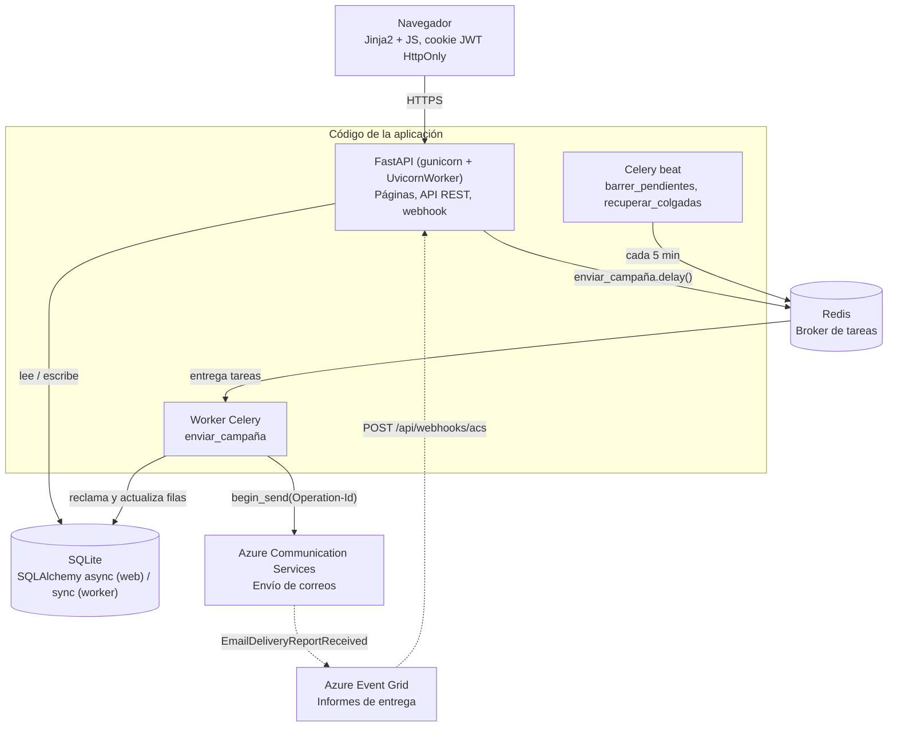
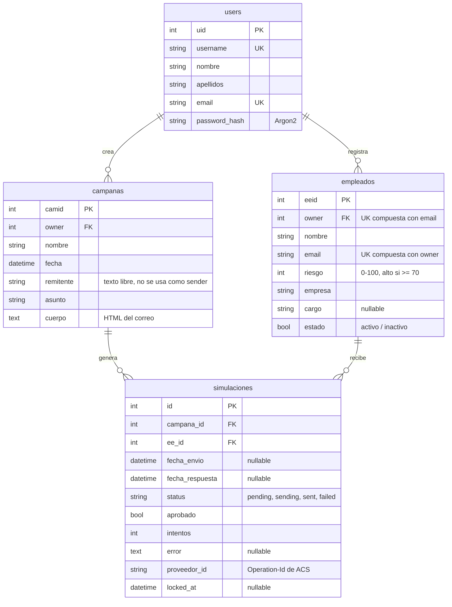
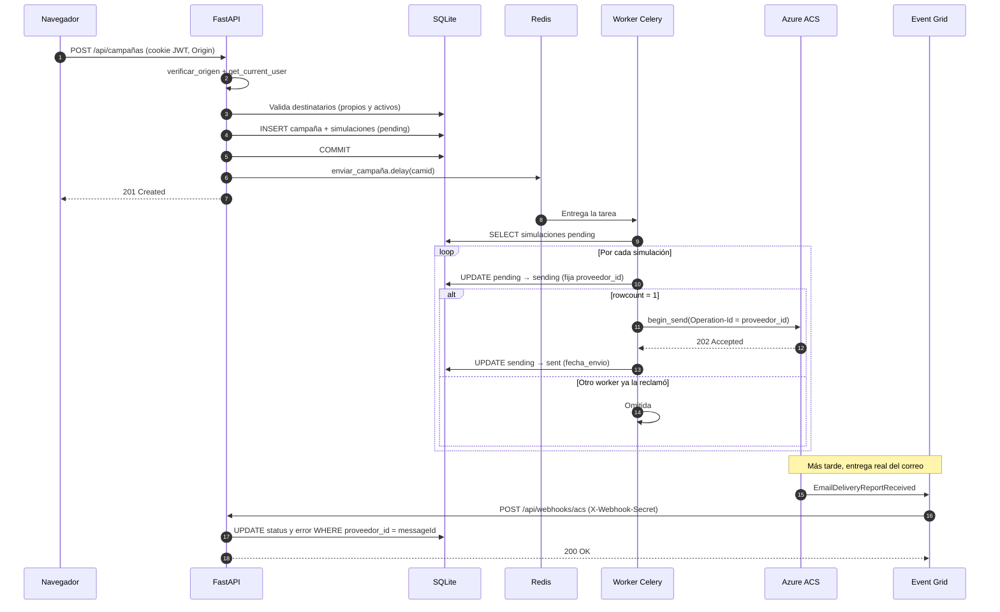
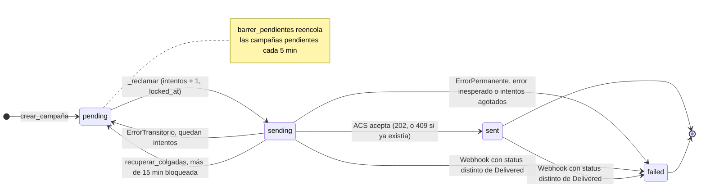
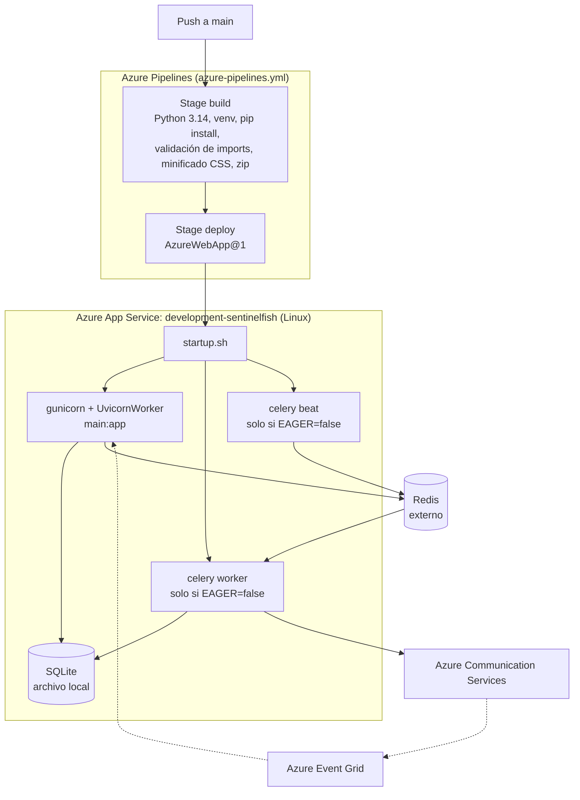

# Sentinel · Documentación técnica

Plataforma de simulación y detección de phishing para pymes colombianas.

**Autor:** Jose Miguel Franco Zabala — ID 100097477 · **Base:** rama `main`, commit `d4c62b5` · **Versión:** 1.0

- [Parte I · Arquitectura](#parte-i--arquitectura)
- [Parte II · Historias de usuario y criterios de aceptación](#parte-ii--historias-de-usuario-y-criterios-de-aceptación)

---

## Parte I · Arquitectura

Los diagramas usan [Mermaid](https://mermaid.js.org/). En mdBook se renderizan con el preprocesador `mdbook-mermaid`.

- [1. Arquitectura general](#1-arquitectura-general)
- [2. Modelo de datos](#2-modelo-de-datos)
- [3. Secuencia: creación y envío de una campaña](#3-secuencia-creación-y-envío-de-una-campaña)
- [4. Estados de una simulación](#4-estados-de-una-simulación)
- [5. Despliegue](#5-despliegue)

### 1. Arquitectura general

**Notas**

- Con `CELERY_TASK_ALWAYS_EAGER=true` (modo desarrollo) no se usan Redis, worker ni beat: la tarea `enviar_campaña` se ejecuta dentro del proceso web.
- La base de datos es la fuente de verdad. La idempotencia del envío se basa en el reclamo atómico `pending → sending` y en un `proveedor_id` (Operation-Id de ACS) que se conserva entre reintentos.
- Los métodos `POST/PUT/PATCH/DELETE` solo se aceptan desde `ALLOWED_ORIGINS` (protección CSRF). El webhook es la única excepción y se autentica con la cabecera `X-Webhook-Secret`.

### 2. Modelo de datos

**Notas**

- Todos los borrados van en cascada desde `users` (`cascade="all, delete-orphan"`).
- El email del empleado es único por dueño, no global, para no revelar empleados de otros usuarios.
- La autorización se basa en la columna `owner`: si un recurso no existe o pertenece a otro usuario se responde 404 en ambos casos (`core/permisos.py`).

### 3. Secuencia: creación y envío de una campaña

**Notas**

- El encolado (paso 6) ocurre después del `COMMIT`. Si Redis no responde, la campaña queda guardada en `pending` y `barrer_pendientes` la encola en el siguiente barrido.
- `POST /api/campañas/{camid}/enviar` vuelve a encolar manualmente una campaña con filas pendientes.
- El webhook lee el campo `status` del evento. Los eventos con `status = Expanded` se ignoran; cualquier valor distinto de `Delivered` marca la fila como `failed` y guarda en `error` el motivo (`deliveryStatusDetails.statusMessage`).
- El webhook no sobrescribe filas que ya salieron de `sending` o `sent`.

### 4. Estados de una simulación

**Notas**

- `EMAIL_MAX_INTENTOS` vale 3 por defecto y `EMAIL_LOCK_TIMEOUT_MINUTOS` vale 15.
- Errores transitorios: timeouts, errores de conexión, HTTP 429 y 5xx. Errores permanentes: el resto de códigos 4xx o configuración faltante.
- Pendiente de implementar: los estados `opened` y `clicked` (definidos en `schemas/simulaciones.py`) y los campos `aprobado` y `fecha_respuesta` todavía no se actualizan en ninguna parte del código.

### 5. Despliegue

**Notas**

- Los secretos y la configuración (`SECRET_KEY`, `SECRET_KEY_AUTH`, `DATABASE_URL`, `ACS_*`, `ALLOWED_ORIGINS`, etc.) viven en las App Settings del App Service. El pipeline usa valores ficticios solo para validar los imports.
- El pipeline no ejecuta tests todavía.
- Limitaciones conocidas de esta topología: SQLite se comparte entre los workers de gunicorn y Celery dentro del mismo contenedor, y si el App Service escala a varias instancias cada una levanta su propio beat. Los barridos se multiplican, pero no se duplican correos gracias al reclamo atómico.

---

## Parte II · Historias de usuario y criterios de aceptación

### 0. Convenciones

#### 0.1. Roles (personas)

| Rol | Descripción |
|---|---|
| **Administrador** | Usuario registrado de la pyme. Responsable de la seguridad sin área de TI dedicada. Es el actor principal de todas las historias funcionales. |
| **Destinatario** | Empleado de la pyme que recibe el correo simulado. No tiene cuenta en la plataforma; su interacción se registra de forma indirecta. |
| **Sistema** | Componente interno (worker, webhook, middleware). Actor de las historias técnicas. |
| **Operador** | Responsable del despliegue y la configuración del entorno. |

#### 0.2. Prioridades (MoSCoW)

| Código | Significado |
|---|---|
| **M** | Must — imprescindible; sin ella el flujo no se completa |
| **S** | Should — importante; afecta la calidad o la confianza en el producto |
| **C** | Could — deseable; mejora la experiencia |

#### 0.3. Notación de los criterios

Los criterios usan el formato **Dado / Cuando / Entonces** (Gherkin), de modo que cada uno sea directamente convertible en una prueba automatizada. Cuando el criterio **no se cumple** en el código actual, se marca con `⚠️` y se indica la desviación concreta y su ubicación.

Códigos HTTP usados: `200` lectura correcta · `201` creación · `204` éxito sin cuerpo · `303` redirección tras formulario · `400` regla de negocio incumplida · `401` sin sesión o credenciales inválidas · `403` origen no permitido · `404` recurso inexistente o ajeno · `409` conflicto de estado · `422` datos que no superan la validación del esquema · `503` dependencia no disponible.

#### 0.4. Índice

| Épica | Historias | Prioridad dominante |
|---|---|---|
| EP-01 Cuentas y sesión | HU-01 … HU-09 | M |
| EP-02 Plantilla de empleados | HU-10 … HU-17 | M |
| EP-03 Constructor de campañas | HU-18 … HU-23 | M |
| EP-04 Motor de envío | HU-24 … HU-28 | M |
| EP-05 Confirmación de entrega | HU-29 … HU-31 | S |
| EP-06 Monitoreo de campañas | HU-32 … HU-35 | S |
| EP-07 Seguridad y plataforma | HU-36 … HU-40 | S |

---

### EP-01 · Cuentas y sesión

#### HU-01 · Registro de cuenta

**Como** administrador de una pyme **quiero** crear una cuenta con mis datos **para** empezar a usar la plataforma sin depender de un proveedor externo.

**Prioridad:** M · **Endpoint:** `POST /api/usuarios` · **Pantalla:** `/registro` · **Archivos:** `routers/usuarios.py`, `schemas/usuarios.py`, `utils/validaciones.py`

**Criterios de aceptación**

- **CA-1.1** Dado que completo usuario, nombre, apellidos, correo y una contraseña de al menos 15 caracteres, cuando envío el formulario, entonces el sistema responde `201` y devuelve `uid`, `username`, `nombre`, `apellidos` y `email`, sin ningún campo de contraseña ni de hash.
- **CA-1.2** Dado que el nombre de usuario ya existe en otra cuenta —sin distinguir mayúsculas de minúsculas—, cuando me registro, entonces recibo `400` con el mensaje *"El usuario con username {username} ya existe."*
- **CA-1.3** Dado que el correo ya está registrado en otra cuenta, cuando me registro, entonces recibo `400` con el mensaje *"Ya existe un usuario con email {email}"*.
- **CA-1.4** Dado que introduzco una contraseña de 14 caracteres o menos, cuando envío el formulario, entonces recibo `422` y la cuenta no se crea.
- **CA-1.5** Dado que introduzco un correo con formato inválido, cuando envío el formulario, entonces recibo `422` y la cuenta no se crea.
- **CA-1.6** Dado que el nombre de usuario supera 50 caracteres o el nombre o los apellidos están vacíos, cuando envío el formulario, entonces recibo `422`.
- **CA-1.7** Dado un registro válido, cuando consulto la base de datos, entonces el correo está almacenado en minúsculas y la contraseña figura como hash Argon2, nunca en texto plano.
- **CA-1.8** Dado que envío el registro desde un origen no incluido en la lista blanca, cuando la petición llega, entonces recibo `403` con el mensaje *"Origen de la solicitud no permitido."*
- **CA-1.9** Dado que ya tengo una sesión activa, cuando visito `/registro`, entonces soy redirigido con `303` a `/dashboard`.

---

#### HU-02 · Inicio de sesión

**Como** administrador **quiero** autenticarme con mi usuario y contraseña **para** acceder a mis campañas y empleados de forma segura.

**Prioridad:** M · **Endpoint:** `POST /api/usuarios/token` · **Pantalla:** `/login` · **Archivos:** `core/auth.py`, `routers/usuarios.py`

**Criterios de aceptación**

- **CA-2.1** Dado que introduzco credenciales correctas, cuando envío el formulario, entonces el sistema responde `204` sin cuerpo y establece la cookie `access_token`.
- **CA-2.2** Dado un inicio de sesión correcto, cuando inspecciono la cookie, entonces verifica `HttpOnly`, `SameSite=Lax`, `Path=/`, `Max-Age=1800` y `Secure` conforme a la configuración del entorno.
- **CA-2.3** Dado un inicio de sesión correcto, cuando inspecciono el cuerpo y el JavaScript de la página, entonces el token JWT no aparece en ninguno de los dos.
- **CA-2.4** Dado que introduzco una contraseña incorrecta, cuando envío el formulario, entonces recibo `401` con el mensaje *"No se pudieron validar las credenciales."*
- **CA-2.5** Dado que introduzco un nombre de usuario inexistente, cuando envío el formulario, entonces recibo el mismo `401` y el mismo mensaje que en CA-2.4.
- **CA-2.6** Dado un usuario inexistente y una contraseña incorrecta, cuando comparo los tiempos de respuesta de ambas peticiones, entonces la diferencia no permite distinguir si el usuario existe.
- **CA-2.7** Dado que escribo mi nombre de usuario con mayúsculas distintas a las registradas, cuando inicio sesión, entonces el acceso es correcto.
- **CA-2.8** Dado que ya tengo una sesión activa, cuando visito `/login`, entonces soy redirigido con `303` a `/dashboard`.

---

#### HU-03 · Cierre de sesión

**Como** administrador **quiero** cerrar mi sesión **para** dejar de exponer mi cuenta en un equipo compartido.

**Prioridad:** M · **Endpoint:** `POST /api/usuarios/logout` · **Archivos:** `core/auth.py`, `routers/usuarios.py`, `static/js/auth.js`

**Criterios de aceptación**

- **CA-3.1** Dado que tengo sesión iniciada, cuando pulso "Cerrar sesión", entonces el sistema responde `204` y elimina la cookie del navegador.
- **CA-3.2** Dado que mi token ya expiró, cuando pulso "Cerrar sesión", entonces la petición se acepta igualmente con `204` y la cookie se elimina.
- **CA-3.3** Dado que cerré sesión, cuando intento acceder a `/dashboard`, entonces soy redirigido con `303` a `/login`.
- **CA-3.4** Dado que cerré sesión, cuando pulso el botón "Atrás" del navegador, entonces el navegador vuelve a solicitar la página al servidor y este redirige a `/login`; no se muestra contenido en caché.
- **CA-3.5** Dado que la petición de cierre falla por un error de red, cuando el navegador no recibe confirmación, entonces la interfaz muestra un aviso de error y **no** simula un cierre exitoso ni redirige.

---

#### HU-04 · Consultar mi perfil

**Como** administrador **quiero** ver los datos de mi cuenta **para** verificar que son correctos.

**Prioridad:** M · **Endpoint:** `GET /api/usuarios/me` · **Pantalla:** `/cuenta`

**Criterios de aceptación**

- **CA-4.1** Dado que tengo sesión activa, cuando consulto mi perfil, entonces recibo `200` con `uid`, `username`, `nombre`, `apellidos` y `email`.
- **CA-4.2** Dado que no tengo sesión, cuando consulto mi perfil, entonces recibo `401` con el mensaje *"Token invalido o expirado."*
- **CA-4.3** Dado que envío un token con firma manipulada, cuando consulto mi perfil, entonces recibo `401`.

---

#### HU-05 · Actualizar mi perfil

**Como** administrador **quiero** modificar mi nombre, usuario o correo **para** mantener mis datos actualizados.

**Prioridad:** S · **Endpoint:** `PATCH /api/usuarios/{uid}` · **Pantalla:** `/cuenta` · **Archivos:** `routers/usuarios.py`, `templates/cuenta.html`

**Criterios de aceptación**

- **CA-5.1** Dado que modifico únicamente el nombre, cuando guardo, entonces recibo `200` y solo ese campo cambia; usuario, apellidos y correo conservan su valor.
- **CA-5.2** Dado que no modifico ningún campo, cuando pulso guardar, entonces recibo `400` con el mensaje *"No se detecto ningun cambio en los datos del usuario."*
- **CA-5.3** Dado que cambio mi nombre de usuario por uno ya ocupado, cuando guardo, entonces recibo `400` con el mensaje de duplicidad y ningún campo se modifica.
- **CA-5.4** Dado que cambio mi correo por uno ya registrado, cuando guardo, entonces recibo `400` y ningún campo se modifica.
- **CA-5.5** Dado que cambio mi correo escribiéndolo en mayúsculas, cuando guardo, entonces se almacena en minúsculas.
- **CA-5.6** Dado que intento modificar el perfil de otro usuario, cuando envío la petición, entonces recibo `404`.
- **CA-5.7** Dado que guardo cambios correctamente, cuando la interfaz recibe la respuesta, entonces los nuevos valores pasan a ser la referencia para detectar cambios posteriores.

---

#### HU-06 · Eliminar mi cuenta

**Como** administrador **quiero** eliminar mi cuenta y todos mis datos **para** ejercer mi derecho de supresión.

**Prioridad:** S · **Endpoint:** `DELETE /api/usuarios/{uid}` · **Pantalla:** `/cuenta` · **Archivos:** `routers/usuarios.py`, `models/__init__.py`, `templates/cuenta.html`

**Criterios de aceptación**

- **CA-6.1** Dado que estoy en la pantalla de cuenta, cuando abro el diálogo de eliminación, entonces veo el número exacto de campañas, empleados y simulaciones que se van a destruir.
- **CA-6.2** Dado que el diálogo está abierto, cuando el texto escrito no coincide exactamente con mi nombre de usuario, entonces el botón de confirmación permanece deshabilitado.
- **CA-6.3** Dado que confirmo la eliminación, cuando la petición se procesa, entonces recibo `204`, la cuenta se elimina y la cookie de sesión se borra.
- **CA-6.4** Dado que confirmo la eliminación, cuando consulto la base de datos, entonces no queda ninguna campaña, empleado ni simulación asociada a mi cuenta.
- **CA-6.5** Dado que intento eliminar la cuenta de otro usuario, cuando envío la petición, entonces recibo `404`.

---

#### HU-07 · Cambiar el tema visual

**Como** administrador **quiero** alternar entre tema claro y oscuro **para** trabajar cómodamente según la iluminación.

**Prioridad:** C · **Endpoint:** `POST /cuenta/tema` · **Archivos:** `main.py`, `templates/layout.html`

**Criterios de aceptación**

- **CA-7.1** Dado que selecciono el tema oscuro, cuando se procesa el formulario, entonces recibo `303` hacia `/cuenta` y se establece la cookie `tema` con valor `dark` y vigencia de un año.
- **CA-7.2** Dado que recargo cualquier página con el tema oscuro guardado, entonces el HTML se entrega con `data-theme="dark"` y no se observa un destello del tema claro durante la carga.
- **CA-7.3** Dado que envío un valor distinto de `light` o `dark`, cuando se procesa el formulario, entonces recibo `422`.
- **CA-7.4** Dado que no tengo la cookie de tema, cuando abro cualquier página, entonces la interfaz se presenta en tema claro.

---

#### HU-08 · Protección de rutas privadas

**Como** administrador **quiero** que nadie sin sesión pueda ver mis datos **para** proteger la información de mi organización.

**Prioridad:** M · **Archivos:** `main.py`, `core/auth.py`

**Criterios de aceptación**

- **CA-8.1** Dado que no tengo sesión, cuando solicito `/dashboard`, `/empleados`, `/campañas`, `/simulacion`, `/deteccion` o `/cuenta`, entonces soy redirigido con `303` a `/login`.
- **CA-8.2** Dado que no tengo sesión, cuando solicito cualquier ruta bajo `/api/` que requiera autenticación, entonces recibo `401` con cuerpo JSON y no una redirección.
- **CA-8.3** Dado que mi token expiró, cuando solicito una página HTML, entonces soy redirigido a `/login`; cuando solicito una ruta de API, entonces recibo `401`.
- **CA-8.4** Dado que accedo a `/`, `/login` o `/registro` sin sesión, entonces las páginas se sirven con normalidad.

---

#### HU-09 · Aislamiento de datos entre cuentas

**Como** administrador **quiero** que mis empleados y campañas sean invisibles para otras cuentas **para** garantizar la confidencialidad entre organizaciones.

**Prioridad:** M · **Archivos:** `core/permisos.py`, `routers/*.py`

**Criterios de aceptación**

- **CA-9.1** Dado un empleado que pertenece a otra cuenta, cuando lo solicito por su identificador, entonces recibo `404` y **no** `403`.
- **CA-9.2** Dado un identificador de campaña inexistente, cuando lo solicito, entonces recibo `404` con exactamente la misma respuesta que en CA-9.1, de modo que no se pueda deducir si el recurso existe.
- **CA-9.3** Dado que listo empleados, campañas o simulaciones, entonces la respuesta contiene únicamente registros cuyo propietario es mi cuenta.
- **CA-9.4** Dado que intento eliminar o modificar un recurso de otra cuenta, cuando envío la petición, entonces recibo `404` y el recurso permanece intacto.
- **CA-9.5** Dado que dos cuentas registran al mismo correo como empleado, entonces ambas operaciones se aceptan, porque la unicidad del correo es por propietario y no global.

---

### EP-02 · Plantilla de empleados

#### HU-10 · Registrar empleado

**Como** administrador **quiero** dar de alta a los empleados de mi empresa **para** poder incluirlos como destinatarios de las campañas.

**Prioridad:** M · **Endpoint:** `POST /api/empleados` · **Pantalla:** `/empleados` · **Archivos:** `routers/empleados.py`, `schemas/empleados.py`, `utils/validaciones.py`

**Criterios de aceptación**

- **CA-10.1** Dado que completo nombre, correo, empresa y cargo, cuando guardo, entonces recibo `201` con el empleado creado y su identificador.
- **CA-10.2** Dado que no indico el índice de riesgo, cuando se crea el empleado, entonces se asigna `100` por defecto.
- **CA-10.3** Dado que no indico el estado, cuando se crea el empleado, entonces se marca como activo.
- **CA-10.4** Dado que indico un índice de riesgo menor que 0 o mayor que 100, cuando guardo, entonces recibo `422`.
- **CA-10.5** Dado que indico un correo con formato inválido, cuando guardo, entonces recibo `422`.
- **CA-10.6** Dado que el correo ya existe en mi plantilla —sin distinguir mayúsculas—, cuando guardo, entonces recibo `400` con el mensaje *"Ya existe un empleado con email {email}"*.
- **CA-10.7** Dado que dejo vacía la empresa, cuando guardo, entonces recibo `422`.
- **CA-10.8** Dado que el cargo se omite, cuando guardo, entonces el empleado se crea con el cargo vacío.

---

#### HU-11 · Listar la plantilla de empleados

**Como** administrador **quiero** ver todos mis empleados ordenados por nivel de riesgo **para** identificar a quién debo priorizar en la formación.

**Prioridad:** M · **Endpoint:** `GET /api/empleados` · **Pantalla:** `/empleados`

**Criterios de aceptación**

- **CA-11.1** Dado que tengo empleados registrados, cuando consulto el listado, entonces recibo `200` con todos mis empleados ordenados por índice de riesgo de mayor a menor.
- **CA-11.2** Dado que existen empleados de otras cuentas, cuando consulto el listado, entonces ninguno aparece en la respuesta.
- **CA-11.3** Dado que un empleado tiene simulaciones asociadas, cuando consulto el listado, entonces la respuesta las incluye sin generar una consulta adicional por empleado.
- **CA-11.4** Dado que consulto el listado, entonces cada elemento expone su índice de riesgo y su estado.
  > ⚠️ **Desviación actual:** `EmpleadoResponse` (`schemas/empleados.py`) hereda de `EmpleadoBase`, que no incluye `riesgo` ni `estado`. La API no los devuelve, aunque la vista HTML sí los muestra porque se renderiza desde el ORM en `main.py`. Este criterio **falla** hoy.

---

#### HU-12 · Consultar un empleado

**Como** administrador **quiero** ver el detalle de un empleado **para** revisar sus datos antes de editarlo.

**Prioridad:** S · **Endpoint:** `GET /api/empleados/{eeid}`

**Criterios de aceptación**

- **CA-12.1** Dado un empleado propio, cuando lo consulto, entonces recibo `200` con sus datos.
- **CA-12.2** Dado un identificador inexistente, cuando lo consulto, entonces recibo `404`.
- **CA-12.3** Dado un empleado de otra cuenta, cuando lo consulto, entonces recibo `404`.

---

#### HU-13 · Editar empleado

**Como** administrador **quiero** actualizar los datos de un empleado **para** corregir información o ajustar su nivel de riesgo.

**Prioridad:** M · **Endpoint:** `PATCH /api/empleados/{eeid}` · **Pantalla:** `/empleados`

**Criterios de aceptación**

- **CA-13.1** Dado que modifico solo el cargo, cuando guardo, entonces recibo `200` y únicamente el cargo cambia.
- **CA-13.2** Dado que no envío ningún campo, cuando guardo, entonces recibo `400` con el mensaje *"No se proporcionaron cambios para actualizar el empleado."*
- **CA-13.3** Dado que cambio el correo por uno ya usado por otro empleado de mi cuenta, cuando guardo, entonces recibo `400`.
- **CA-13.4** Dado que cambio el correo por el mismo que ya tenía, cuando guardo, entonces la operación se acepta y no se reporta duplicidad.
- **CA-13.5** Dado que modifico el índice de riesgo, cuando guardo, entonces el nuevo valor se persiste.
  > ⚠️ **Desviación actual:** `EmpleadoUpdate` no declara el campo `riesgo`, por lo que el valor se descarta silenciosamente y el riesgo no cambia. Este criterio **falla** hoy.

---

#### HU-14 · Reemplazar empleado

**Como** administrador **quiero** reemplazar todos los datos de un empleado en una sola operación **para** corregir registros inconsistentes.

**Prioridad:** C · **Endpoint:** `PUT /api/empleados/{eeid}`

**Criterios de aceptación**

- **CA-14.1** Dado que envío todos los campos, cuando guardo, entonces recibo `200` y el registro se reemplaza por completo.
- **CA-14.2** Dado que envío un correo duplicado de otro empleado de mi cuenta, cuando guardo, entonces recibo `400`.
- **CA-14.3** Dado que dejo el cargo vacío, cuando guardo, entonces el cargo queda realmente vacío y no con el texto `"None"`.
  > ⚠️ **Desviación actual:** `routers/empleados.py:93` aplica `str(empleado.cargo)` sobre un valor nulo, de modo que se almacena la cadena `"None"`. Este criterio **falla** hoy.

---

#### HU-15 · Eliminar empleado

**Como** administrador **quiero** dar de baja a un empleado **para** que no reciba más campañas.

**Prioridad:** M · **Endpoint:** `DELETE /api/empleados/{eeid}`

**Criterios de aceptación**

- **CA-15.1** Dado un empleado propio, cuando lo elimino, entonces recibo `204`.
- **CA-15.2** Dado un empleado con simulaciones asociadas, cuando lo elimino, entonces sus simulaciones se eliminan en cascada y las campañas permanecen.
- **CA-15.3** Dado un empleado de otra cuenta, cuando intento eliminarlo, entonces recibo `404` y el empleado permanece.

---

#### HU-16 · Activar y desactivar empleado

**Como** administrador **quiero** suspender temporalmente a un empleado **para** excluirlo de las campañas sin perder su historial.

**Prioridad:** S · **Endpoint:** `PATCH /api/empleados/{eeid}` · **Pantalla:** `/empleados`

**Criterios de aceptación**

- **CA-16.1** Dado un empleado activo, cuando pulso el control de estado, entonces se envía `PATCH` con `estado: false` y recibo `200`.
- **CA-16.2** Dado un empleado inactivo, cuando pulso el control de estado, entonces el nuevo valor es `true` y recibo `200`.
- **CA-16.3** Dado un empleado inactivo, cuando abro el asistente de creación de campaña, entonces no aparece en la lista de destinatarios seleccionables.
- **CA-16.4** Dado un empleado inactivo, cuando intento usarlo como destinatario enviando la petición directamente, entonces recibo `400`.
- **CA-16.5** Dado que la operación falla, entonces el botón se reactiva y se muestra el mensaje de error; no queda bloqueado.

---

#### HU-17 · Panel resumen de empleados

**Como** administrador **quiero** ver indicadores agregados de mi plantilla **para** dimensionar el riesgo de mi organización de un vistazo.

**Prioridad:** S · **Pantalla:** `/empleados` · **Archivos:** `main.py`, `templates/empleados.html`

**Criterios de aceptación**

- **CA-17.1** Dado que tengo empleados, cuando abro la pantalla, entonces veo cuatro indicadores: total, riesgo alto, activos e inactivos.
- **CA-17.2** Dado que un empleado tiene índice de riesgo mayor o igual a 70, entonces se cuenta en el indicador de riesgo alto.
- **CA-17.3** Dado que todos los indicadores son visibles, entonces sus valores se calculan a partir de los datos de mi cuenta y no de valores fijos.
- **CA-17.4** Dado que escribo "perez" en el buscador, cuando existe un empleado llamado "Pérez", entonces aparece en los resultados; la búsqueda ignora tildes y mayúsculas.
- **CA-17.5** Dado que la plantilla supera el tamaño de página, entonces la tabla pagina los resultados.

---

### EP-03 · Constructor de campañas

#### HU-18 · Crear una campaña de phishing simulado

**Como** administrador **quiero** crear una campaña eligiendo nombre, destinatarios y contenido **para** ejecutar un simulacro formativo en mi empresa.

**Prioridad:** M · **Endpoint:** `POST /api/campañas` · **Pantalla:** `/simulacion` · **Archivos:** `routers/campañas.py`, `schemas/campañas.py`, `templates/simulacion.html`

**Criterios de aceptación**

- **CA-18.1** Dado que completo los tres pasos del asistente, cuando confirmo, entonces recibo `201` con el identificador de la campaña creada.
- **CA-18.2** Dado que la campaña se crea con N destinatarios, cuando consulto sus simulaciones, entonces existen exactamente N registros en estado `pending`, uno por destinatario.
- **CA-18.3** Dado que la campaña se crea correctamente, cuando finaliza la operación, entonces se ha encolado la tarea de envío y los correos no se envían dentro de la petición HTTP.
- **CA-18.4** Dado que no selecciono ningún destinatario, cuando confirmo, entonces recibo `400` con el mensaje *"Simulacion invalida. Ningun empleado ha sido seleccionado."*
- **CA-18.5** Dado que envío el identificador de un empleado inactivo o de otra cuenta, cuando confirmo, entonces recibo `400` con el mensaje *"Uno o mas destinatarios no existen o estan inactivos."* y la campaña no se crea.
- **CA-18.6** Dado que el arreglo de destinatarios contiene identificadores repetidos, cuando confirmo, entonces se deduplican y se crea un solo registro por empleado.
- **CA-18.7** Dado que el remitente no tiene formato de correo válido, cuando confirmo, entonces recibo `422`.
- **CA-18.8** Dado que el nombre de la campaña excede 100 caracteres, cuando confirmo, entonces recibo `422`.
- **CA-18.9** Dado que el encolado del envío falla, cuando la campaña ya fue guardada, entonces la campaña permanece creada con sus simulaciones en `pending` y el error se registra en el diario sin propagarse al usuario.
- **CA-18.10** Dado que una campaña no se puede editar, cuando necesito corregirla, entonces debo eliminarla y crearla de nuevo.
  > ⚠️ **Carencia actual:** no existe `PUT` ni `PATCH /api/campañas/{camid}`.

---

#### HU-19 · Seleccionar destinatarios con búsqueda

**Como** administrador **quiero** filtrar y seleccionar empleados en el paso 2 **para** elegir el público de la campaña sin recorrer toda la plantilla.

**Prioridad:** M · **Pantalla:** `/simulacion` (paso 2) · **Archivo:** `templates/simulacion.html`

**Criterios de aceptación**

- **CA-19.1** Dado que escribo un fragmento del nombre o del correo, cuando escribo, entonces la lista se filtra en tiempo real a los empleados coincidentes.
- **CA-19.2** Dado que escribo "perez", cuando existe "Pérez", entonces el empleado aparece; la comparación ignora tildes y mayúsculas.
- **CA-19.3** Dado que marco o desmarco empleados, entonces el contador muestra "*N* de *M* seleccionados" y la fila seleccionada se resalta visualmente.
- **CA-19.4** Dado que no he seleccionado a nadie, cuando pulso "Siguiente", entonces el asistente no avanza y muestra el mensaje *"Selecciona al menos un empleado como destinatario."*
- **CA-19.5** Dado que selecciono al menos uno, entonces el mensaje de error desaparece y puedo avanzar.
- **CA-19.6** Dado que la plantilla contiene empleados inactivos, entonces no aparecen en esta lista.

---

#### HU-20 · Componer el cuerpo del correo simulado

**Como** administrador **quiero** redactar el correo con formato e imágenes **para** que el simulacro sea realista y formativo.

**Prioridad:** M · **Pantalla:** `/simulacion` (paso 3) · **Archivo:** `static/js/rich-text-editor.js`

**Criterios de aceptación**

- **CA-20.1** Dado que selecciono texto y aplico negrita, cursiva, subrayado, tachado o alineación, cuando compruebo el contenido, entonces el formato se ha aplicado.
- **CA-20.2** Dado que inserto una lista ordenada o desordenada, entonces se refleja en el cuerpo del mensaje.
- **CA-20.3** Dado que inserto un enlace con URL y texto, entonces el texto visible aparece como enlace al destino indicado.
- **CA-20.4** Dado que inserto una imagen por URL, entonces se previsualiza en el editor y se incluye en el cuerpo enviado.
- **CA-20.5** Dado que selecciono un archivo de imagen de hasta 1 MB en formato PNG, JPG, GIF o WebP, entonces se inserta incrustada.
- **CA-20.6** Dado que selecciono una imagen de más de 1 MB, cuando la elijo, entonces recibo el aviso *"La imagen supera 1 MB…"* y no se inserta.
- **CA-20.7** Dado que pego contenido con etiquetas `script`, `iframe`, `object`, `embed`, `form`, `svg` o `math`, cuando el contenido sale del editor, entonces esas etiquetas han sido eliminadas.
- **CA-20.8** Dado que introduzco una URL con esquema `javascript:`, cuando el contenido sale del editor, entonces el atributo se elimina.
- **CA-20.9** Dado que introduzco una imagen con URL de datos en formato SVG, entonces se rechaza; solo se admiten formatos de trama.
- **CA-20.10** Dado que el cuerpo está vacío, cuando intento crear la campaña, entonces no se permite y se muestra *"Falta completar … el cuerpo del correo."*
- **CA-20.11** Dado que activo la vista de código fuente, entonces puedo editar el HTML y el contenido se sincroniza con el editor.
- **CA-20.12** Dado que el HTML del cuerpo llega al servidor, entonces este lo valida antes de almacenarlo.
  > ⚠️ **Carencia actual:** la sanitización existe solo en el cliente; `POST /api/campañas` almacena el HTML tal como llega.

---

#### HU-21 · Usar plantillas de campaña precargadas

**Como** administrador sin experiencia en redacción de correos **quiero** partir de una plantilla **para** crear una campaña creíble en pocos pasos.

**Prioridad:** S · **Pantalla:** `/simulacion` (paso 3) · **Archivo:** `templates/simulacion.html`

**Criterios de aceptación**

- **CA-21.1** Dado que abro el paso 3, entonces veo cinco plantillas: verificación de cuenta, factura pendiente, buzón lleno, premio y caducidad de contraseña.
- **CA-21.2** Dado que selecciono una plantilla, entonces se rellenan automáticamente remitente, asunto y cuerpo.
- **CA-21.3** Dado que aplico una plantilla y luego edito el cuerpo, entonces la plantilla deja de considerarse seleccionada y el contenido editado es el que se envía.
- **CA-21.4** Dado que uso una plantilla, entonces su remitente pertenece a un dominio ficticio y no suplanta la identidad de una marca real.

---

#### HU-22 · Enviar una campaña

**Como** administrador **quiero** activar el envío de una campaña **para** que los correos lleguen a los destinatarios en el momento que decido.

**Prioridad:** M · **Endpoint:** `POST /api/campañas/{camid}/enviar` · **Pantalla:** `/campañas` · **Archivos:** `routers/campañas.py`, `worker/tasks.py`

**Criterios de aceptación**

- **CA-22.1** Dado que la campaña tiene simulaciones en estado `pending`, cuando pulso "Activar y enviar", entonces recibo `200` con el identificador de la campaña, el número de pendientes y la confirmación de encolado.
- **CA-22.2** Dado que la campaña no tiene simulaciones pendientes, cuando pulso el botón, entonces recibo `409` con el mensaje *"La campaña no tiene simulaciones pendientes por enviar."*
- **CA-22.3** Dado que la campaña no tiene pendientes, entonces el botón aparece deshabilitado con el texto "Sin pendientes".
- **CA-22.4** Dado que la campaña tiene pendientes, entonces el botón muestra el número: "Activar y enviar (N)".
- **CA-22.5** Dado que el intermediario de mensajería no responde, cuando pulso el botón, entonces recibo `503` con *"No se pudo encolar el envío. Intenta nuevamente."*
- **CA-22.6** Dado que el encolado se realiza correctamente, entonces la interfaz muestra la confirmación y recarga la página para reflejar los nuevos estados.
- **CA-22.7** Dado que la campaña pertenece a otra cuenta, cuando solicito el envío, entonces recibo `404`.

---

#### HU-23 · Eliminar una campaña

**Como** administrador **quiero** eliminar una campaña **para** limpiar simulacros obsoletos o mal configurados.

**Prioridad:** M · **Endpoint:** `DELETE /api/campañas/{camid}` · **Pantalla:** `/campañas`

**Criterios de aceptación**

- **CA-23.1** Dado que pulso eliminar, entonces se abre un diálogo que muestra el nombre de la campaña y su número de destinatarios.
- **CA-23.2** Dado que confirmo, cuando la petición se procesa, entonces recibo `204` y la campaña desaparece de la lista.
- **CA-23.3** Dado que confirmo la eliminación, entonces todas las simulaciones asociadas se eliminan en cascada y los empleados permanecen.
- **CA-23.4** Dado que la petición falla, entonces el mensaje de error se muestra dentro del diálogo y este permanece abierto.
- **CA-23.5** Dado que la campaña pertenece a otra cuenta, cuando intento eliminarla, entonces recibo `404`.

---

### EP-04 · Motor de envío

#### HU-24 · Envío sin correos duplicados

**Como** administrador **quiero** que cada destinatario reciba el correo exactamente una vez **para** que el simulacro sea creíble y las métricas sean válidas.

**Prioridad:** M · **Archivo:** `worker/tasks.py` · **Componente:** `enviar_campaña`

**Criterios de aceptación**

- **CA-24.1** Dado que la tarea de envío de una campaña se ejecuta dos veces seguidas, cuando finaliza la segunda, entonces cada destinatario ha recibido exactamente un correo.
- **CA-24.2** Dado que dos procesos de envío procesan la misma campaña simultáneamente, cuando ambos terminan, entonces cada fila ha sido reclamada por uno solo y el otro la reporta como omitida.
- **CA-24.3** Dado que una fila ya fue reclamada, cuando otro proceso intenta reclamarla, entonces la actualización condicional no afecta ninguna fila y el proceso no la envía.
- **CA-24.4** Dado que una fila se reintenta, entonces el identificador de operación enviada al proveedor es el mismo que en el intento anterior.
- **CA-24.5** Dado que el proveedor informa que la operación ya existía porque un intento anterior sí llegó, entonces la fila se marca como enviada y no se genera un segundo correo.
- **CA-24.6** Dado un envío correcto, cuando consulto la fila, entonces su estado es `sent`, tiene fecha de envío y no tiene error asociado.

---

#### HU-25 · Reintentos con clasificación de errores

**Como** administrador **quiero** que los fallos temporales se reintenten solos y los definitivos se reporten **para** no perder envíos recuperables ni insistir en los imposibles.

**Prioridad:** M · **Archivos:** `worker/tasks.py`, `services/email.py`

**Criterios de aceptación**

- **CA-25.1** Dado un error de tiempo de espera agotado, límite de tasa (429) o error del servidor (5xx), cuando se produce, entonces la fila vuelve a `pending`, conserva el motivo en el campo de error y queda disponible para el barrido.
- **CA-25.2** Dado un destinatario suprimido, una dirección inválida o un rechazo del proveedor, cuando se produce, entonces la fila pasa a `failed` de inmediato y no se reintenta.
- **CA-25.3** Dado que una fila acumula tres intentos fallidos por error transitorio, cuando se produce el cuarto, entonces pasa a `failed` con el motivo del último error.
- **CA-25.4** Dado un error inesperado no clasificado, cuando se produce, entonces la fila pasa a `failed` con el mensaje *"Error inesperado: …"* y no se reintenta indefinidamente.
- **CA-25.5** Dado que el resultado no se puede guardar por bloqueo de la base de datos, entonces el sistema reintenta la escritura hasta tres veces antes de desistir, y deja la fila en `sending` para recuperación posterior.

---

#### HU-26 · Recuperación de envíos colgados

**Como** operador **quiero** que las simulaciones atascadas se liberen automáticamente **para** que ninguna quede pendiente indefinidamente.

**Prioridad:** S · **Archivo:** `worker/tasks.py` · **Componente:** `recuperar_colgadas`

**Criterios de aceptación**

- **CA-26.1** Dado que una fila permanece en `sending` con marca de bloqueo más antigua que 15 minutos, cuando se ejecuta la tarea de recuperación, entonces vuelve a `pending` y se libera la marca.
- **CA-26.2** Dado que una fila está en `sending` desde hace menos de 15 minutos, cuando se ejecuta la tarea, entonces no se modifica.
- **CA-26.3** Dado que la tarea se ejecuta cada 300 segundos, entonces se registra en el diario el número de filas recuperadas cuando es mayor que cero.
- **CA-26.4** Dado que una fila recuperada se reenvía, entonces reutiliza el identificador de operación previo y no genera un correo duplicado.

---

#### HU-27 · Barrido de campañas pendientes

**Como** operador **quiero** que las campañas con envíos pendientes se reencolen automáticamente **para** cubrir la caída del intermediario en el momento del alta.

**Prioridad:** S · **Archivo:** `worker/tasks.py` · **Componente:** `barrer_pendientes`

**Criterios de aceptación**

- **CA-27.1** Dado que existen campañas con simulaciones en `pending`, cuando se ejecuta el barrido, entonces cada una se encola para envío.
- **CA-27.2** Dado que una campaña ya fue procesada por completo, cuando se ejecuta el barrido, entonces no se encola de nuevo.
- **CA-27.3** Dado que existen más campañas pendientes que el límite configurado, entonces el barrido procesa como máximo ese límite por ejecución.
- **CA-27.4** Dado que la tarea se ejecuta cada 300 segundos, entonces no requiere intervención manual.

---

#### HU-28 · Backend de correo sustituible

**Como** operador **quiero** poder operar sin un proveedor de correo configurado **para** demostrar y probar el sistema sin dominio verificado.

**Prioridad:** S · **Archivos:** `services/email.py`, `core/config.py`

**Criterios de aceptación**

- **CA-28.1** Dado `EMAIL_BACKEND=log`, cuando se envía una campaña, entonces no se realiza ninguna llamada externa y se registra en el diario destinatario, asunto e identificador de operación.
- **CA-28.2** Dado `EMAIL_BACKEND=acs`, cuando se envía, entonces se realiza la llamada al proveedor y el resultado se refleja en el estado de la fila.
- **CA-28.3** Dado cualquier backend, entonces la dirección remitente del correo enviado es la configurada en el entorno y no el texto introducido por el usuario en el campo "remitente".
  > ⚠️ **Desviación de expectativa:** el usuario escribe un remitente visible que **no** se usa como dirección de envío. Debe informarse en la interfaz para no generar falsas expectativas.
- **CA-28.4** Dado `EMAIL_BACKEND` con un valor no soportado, cuando se intenta enviar, entonces la fila falla con un error permanente y un mensaje explícito.
- **CA-28.5** Dado que el proveedor no está configurado, cuando se intenta enviar, entonces la fila falla con un error permanente que nombra la variable faltante.

---

### EP-05 · Confirmación de entrega

#### HU-29 · Confirmar la entrega real del correo

**Como** administrador **quiero** saber si el correo llegó al buzón **para** distinguir entre "enviado" y "entregado".

**Prioridad:** S · **Endpoint:** `POST /api/webhooks/acs` · **Archivos:** `routers/webhooks.py`

**Criterios de aceptación**

- **CA-29.1** Dado un evento con estado de entrega confirmada, cuando se procesa, entonces la simulación correspondiente pasa a `sent` y su campo de error queda vacío.
- **CA-29.2** Dado un evento de rebote, supresión o cuarentena, cuando se procesa, entonces la simulación pasa a `failed` y el campo de error contiene el motivo reportado por el proveedor.
- **CA-29.3** Dado un evento de entrega cuyo identificador de mensaje no corresponde a ninguna simulación, cuando se procesa, entonces se ignora sin producir error.
- **CA-29.4** Dado un evento para una simulación que ya avanzó a un estado de interacción, cuando se procesa, entonces el estado no se sobrescribe.
- **CA-29.5** Dado un evento sin identificador de mensaje, cuando se procesa, entonces se ignora.
- **CA-29.6** Dado un cuerpo que no es JSON válido, cuando llega, entonces el punto de recepción responde sin error y registra una advertencia.
- **CA-29.7** Dado un lote de varios eventos, cuando se procesa, entonces cada uno se evalúa de forma independiente y los cambios se confirman en una sola transacción.

---

#### HU-30 · Validar la procedencia del webhook

**Como** operador **quiero** que solo el proveedor pueda enviar eventos de entrega **para** evitar que un tercero altere los estados de las campañas.

**Prioridad:** M · **Endpoint:** `POST /api/webhooks/acs`

**Criterios de aceptación**

- **CA-30.1** Dado que la petición no incluye la cabecera del secreto, entonces recibo `401`.
- **CA-30.2** Dado que la cabecera contiene un valor incorrecto, entonces recibo `401`.
- **CA-30.3** Dado que el secreto no está configurado en el entorno, entonces toda petición recibe `401` —la política es de rechazo por defecto.
- **CA-30.4** Dado que la comparación del secreto se realiza, entonces se usa una función de comparación en tiempo constante, de modo que el tiempo de respuesta no revela cuántos caracteres coinciden.
- **CA-30.5** Dado que la petición proviene del proveedor, entonces no se le exige el encabezado de origen que sí se exige al resto de las rutas.

---

#### HU-31 · Responder al protocolo de validación de suscripción

**Como** operador **quiero** que el sistema complete el alta de la suscripción de eventos **para** que el proveedor no reintente indefinidamente.

**Prioridad:** M · **Endpoint:** `POST /api/webhooks/acs`

**Criterios de aceptación**

- **CA-31.1** Dado un evento de validación de suscripción con su código, cuando se procesa, entonces la respuesta contiene el código de validación en el campo que el proveedor espera.
- **CA-31.2** Dado un evento de validación, entonces ningún estado de simulación se modifica.
- **CA-31.3** Dado un evento de tipo distinto de validación y de entrega, cuando se procesa, entonces se ignora y la respuesta indica éxito.

---

### EP-06 · Monitoreo de campañas

#### HU-32 · Consultar el estado por destinatario

**Como** administrador **quiero** ver el estado de cada destinatario de una campaña **para** saber quién recibió el correo y quién falló.

**Prioridad:** M · **Endpoints:** `GET /api/simulaciones`, `GET /api/simulaciones/{camid}` · **Pantalla:** `/campañas`

**Criterios de aceptación**

- **CA-32.1** Dado que consulto las simulaciones de mi cuenta, entonces recibo `200` con todas las simulaciones de mis campañas.
- **CA-32.2** Dado que consulto las simulaciones de una campaña, entonces recibo únicamente las de esa campaña.
- **CA-32.3** Dado que consulto una campaña de otra cuenta, entonces recibo `404`.
- **CA-32.4** Dado un destinatario cuyo envío falló, entonces su fila muestra el motivo del fallo y el número de intentos.
- **CA-32.5** Dado que solicito el listado general, entonces los registros aparecen ordenados por fecha de envío descendente.

---

#### HU-33 · Filtrar campañas y destinatarios

**Como** administrador **quiero** filtrar por campaña y por rango de fechas **para** analizar un periodo concreto.

**Prioridad:** S · **Pantalla:** `/campañas` · **Archivo:** `templates/campañas.html`

**Criterios de aceptación**

- **CA-33.1** Dado que selecciono una campaña en el filtro, entonces solo se muestran sus destinatarios.
- **CA-33.2** Dado que establezco una fecha inicial, entonces se ocultan los registros anteriores a esa fecha.
- **CA-33.3** Dado que establezco una fecha final, entonces se ocultan los registros posteriores a esa fecha.
- **CA-33.4** Dado que pulso "Limpiar filtros", entonces se restablecen los tres filtros y se muestran todos los registros.
- **CA-33.5** Dado que un filtro no arroja resultados, entonces se muestra el aviso de lista vacía.
- **CA-33.6** Dado que los filtros se aplican, entonces los indicadores agregados se recalculan sobre el conjunto filtrado.

---

#### HU-34 · Ver el avance de cada campaña

**Como** administrador **quiero** ver el progreso de cada campaña **para** saber si está completa o en curso.

**Prioridad:** S · **Pantalla:** `/campañas`

**Criterios de aceptación**

- **CA-34.1** Dado que abro la pantalla, entonces cada campaña muestra total, pendientes, completadas, aprobadas y fallidas.
- **CA-34.2** Dado que una campaña tiene N destinatarios, entonces las barras de progreso representan la proporción de aprobadas, fallidas y sin completar sobre N.
- **CA-34.3** Dado el estado de una campaña, entonces se muestra una insignia que distingue pendiente, enviado, abierto, clic y completado.
- **CA-34.4** Dado que ninguna simulación alcanza el estado `completed`, entonces el indicador de completadas refleja ese valor real.
  > ⚠️ **Carencia actual:** nada en el sistema produce los estados `opened`, `clicked` ni `completed`, ni el campo de fecha de respuesta. Los indicadores correspondientes serán siempre cero.

---

#### HU-35 · Consultar el tema de concientización

**Como** administrador **quiero** ver una pantalla de detección **para** centralizar los correos sospechosos identificados.

**Prioridad:** C · **Pantalla:** `/deteccion`

**Criterios de aceptación**

- **CA-35.1** Dado que abro la pantalla, entonces veo los cuatro indicadores: correos analizados, amenazas detectadas, riesgo alto y precisión estimada.
- **CA-35.2** Dado que existen detecciones registradas, entonces cada fila muestra fecha, empleado, asunto, remitente, puntuación con código de color y reglas disparadas.
- **CA-35.3** Dado que no hay detecciones, entonces se muestra el mensaje *"Aún no hay detecciones registradas."*
- **CA-35.4** Dado que las puntuaciones se clasifican por color, entonces riesgo alto es mayor o igual a 70, medio entre 40 y 69, y bajo menor que 40.
  > ⚠️ **Carencia actual:** la pantalla existe como estructura, pero la ruta no le pasa datos y el motor de análisis no está implementado. Los indicadores muestran guiones.

---

### EP-07 · Seguridad y plataforma

#### HU-36 · Protección contra falsificación de peticiones

**Como** operador **quiero** que solo el propio frontend pueda modificar datos **para** impedir que un sitio externo ejecute acciones en nombre del usuario.

**Prioridad:** M · **Archivos:** `main.py`, `core/config.py`

**Criterios de aceptación**

- **CA-36.1** Dado que envío un `POST`, `PUT`, `PATCH` o `DELETE` con un encabezado de origen autorizado, entonces la petición se procesa.
- **CA-36.2** Dado que envío una petición de escritura con un origen no autorizado, entonces recibo `403` con el mensaje *"Origen de la solicitud no permitido."*
- **CA-36.3** Dado que envío una petición de escritura sin encabezado de origen, entonces recibo `403`.
- **CA-36.4** Dado que la ruta es la de webhooks, entonces no se le exige el encabezado de origen.
- **CA-36.5** Dado que comparo los orígenes configurados, entonces se normalizan sin barra final y en minúsculas, de modo que una diferencia de formato no impide una petición legítima.

---

#### HU-37 · Gestión de caché de recursos estáticos

**Como** operador **quiero** que los recursos se cacheen correctamente **para** no servir versiones obsoletas tras un despliegue ni degradar el rendimiento.

**Prioridad:** S · **Archivos:** `main.py`

**Criterios de aceptación**

- **CA-37.1** Dado un recurso solicitado con el parámetro de versión, cuando la respuesta es correcta, entonces se marca como cacheable por un año de forma inmutable.
- **CA-37.2** Dado un recurso solicitado sin parámetro de versión, entonces se marca para revalidación.
- **CA-37.3** Dado que el contenido de un archivo cambia, entonces su URL versionada cambia y los navegadores solicitan la versión nueva.
- **CA-37.4** Dado cualquier recurso que no sea estático, entonces se marca como no almacenable.
- **CA-37.5** Dado un archivo estático de tamaño suficiente, entonces la respuesta se entrega comprimida.

---

#### HU-38 · Operación sin intermediario de mensajería

**Como** operador **quiero** desplegar sin intermediario de mensajería **para** demostrar el sistema sin infraestructura adicional.

**Prioridad:** S · **Archivos:** `worker/celery_app.py`, `startup.sh`

**Criterios de aceptación**

- **CA-38.1** Dado que la ejecución en modo *eager* está activa, cuando se crea una campaña, entonces el envío se ejecuta dentro del proceso web sin intermediario.
- **CA-38.2** Dado el modo *eager*, cuando la tarea falla, entonces la petición HTTP no falla y la campaña permanece creada.
- **CA-38.3** Dado que el modo *eager* está desactivado, cuando arranca el servicio, entonces se levantan el trabajador y el planificador de tareas periódicas.
- **CA-38.4** Dado cualquier modo, entonces la base de datos es la fuente de verdad y no se almacenan resultados de tareas.

---

#### HU-39 · Despliegue automatizado

**Como** operador **quiero** que cada confirmación en la rama principal se valide y despliegue **para** reducir el error manual en las entregas.

**Prioridad:** S · **Archivo:** `azure-pipelines.yml`

**Criterios de aceptación**

- **CA-39.1** Dado un cambio en la rama principal, entonces se dispara la compilación automáticamente.
- **CA-39.2** Dado que la aplicación no importa correctamente, entonces la compilación falla y no se despliega.
- **CA-39.3** Dado que la compilación tiene éxito, entonces el paquete se publica en el servicio de aplicaciones.
- **CA-39.4** Dado el paquete desplegado, entonces la hoja de estilos se entrega minificada y el repositorio conserva la versión legible.
- **CA-39.5** Dado que la compilación requiere variables de entorno, entonces se usan valores ficticios que no sobrescriben la configuración real del servicio.

---

#### HU-40 · Configuración por entorno

**Como** operador **quiero** que toda la configuración dependa del entorno **para** desplegar el mismo código en desarrollo y en producción.

**Prioridad:** S · **Archivos:** `core/config.py`, `.env`

**Criterios de aceptación**

- **CA-40.1** Dado que falta una variable obligatoria, entonces la aplicación no arranca y el mensaje de error nombra la variable.
- **CA-40.2** Dado que una variable está definida tanto en el entorno como en el archivo de configuración local, entonces prevalece la del entorno.
- **CA-40.3** Dado que el archivo local contiene variables ajenas a la configuración, entonces se ignoran sin producir error.
- **CA-40.4** Dado que la cookie segura está activada, cuando el navegador accede por HTTP, entonces el inicio de sesión no persiste y debe documentarse la excepción para desarrollo local.
- **CA-40.5** Dado que el repositorio se clona por primera vez, entonces existe un archivo de configuración de ejemplo que permite arrancar la aplicación.
  > ⚠️ **Carencia actual:** `.env.example` está referenciado en `.gitignore` pero no existe en el repositorio.

---

### Anexo A · Trazabilidad historia → código

| Historia | Archivo principal | Endpoint o pantalla |
|---|---|---|
| HU-01 … HU-09 | `routers/usuarios.py`, `core/auth.py`, `core/permisos.py`, `main.py` | `/api/usuarios/*`, `/login`, `/registro`, `/cuenta` |
| HU-10 … HU-17 | `routers/empleados.py`, `schemas/empleados.py`, `utils/validaciones.py` | `/api/empleados/*`, `/empleados` |
| HU-18 … HU-23 | `routers/campañas.py`, `schemas/campañas.py`, `templates/simulacion.html`, `templates/campañas.html` | `/api/campañas/*`, `/simulacion`, `/campañas` |
| HU-24 … HU-28 | `worker/tasks.py`, `services/email.py`, `worker/celery_app.py` | Tareas `enviar_campaña`, `barrer_pendientes`, `recuperar_colgadas` |
| HU-29 … HU-31 | `routers/webhooks.py` | `/api/webhooks/acs` |
| HU-32 … HU-35 | `routers/simulaciones.py`, `templates/campañas.html`, `templates/deteccion.html` | `/api/simulaciones/*`, `/campañas`, `/deteccion` |
| HU-36 … HU-40 | `main.py`, `core/config.py`, `azure-pipelines.yml`, `startup.sh` | Transversal |

---

### Anexo B · Criterios que hoy no se cumplen

Estos criterios son los que una primera ejecución de la suite de pruebas marcaría en rojo. Se listan para que puedan planificarse como correcciones con su historia de origen.

| Criterio | Historia | Problema | Ubicación |
|---|---|---|---|
| CA-11.4 | HU-11 | La API no expone `riesgo` ni `estado` del empleado | `schemas/empleados.py` |
| CA-13.5 | HU-13 | El índice de riesgo no se puede modificar por `PATCH` | `schemas/empleados.py` |
| CA-14.3 | HU-14 | Un cargo nulo se guarda como la cadena `"None"` | `routers/empleados.py:93` |
| CA-18.10 | HU-18 | No existe edición de campañas | `routers/campañas.py` |
| CA-20.12 | HU-20 | La sanitización de HTML no se aplica en el servidor | `routers/campañas.py` |
| CA-28.3 | HU-28 | El remitente escrito por el usuario no se usa como remitente real | `services/email.py` |
| CA-34.4 | HU-34 | Los estados `opened`, `clicked` y `completed` nunca se producen | `worker/tasks.py`, `routers/webhooks.py` |
| CA-35.2 … CA-35.4 | HU-35 | La vista de detección no recibe datos ni tiene motor de análisis | `main.py`, `templates/deteccion.html` |
| CA-40.5 | HU-40 | No existe el archivo de configuración de ejemplo | Raíz del repositorio |

---

### Anexo C · Historias planificadas (no implementadas)

Se documentan por separado para no confundirlas con el alcance actual del sistema.

| ID | Historia | Épica prevista |
|---|---|---|
| HU-41 | Como administrador quiero programar una campaña para una fecha y hora concretas para lanzarla sin estar presente | Motor de envío |
| HU-42 | Como administrador quiero registrar aperturas de correo para saber quién lo abrió | Instrumentación |
| HU-43 | Como administrador quiero registrar clics en enlaces para medir la tasa de clic | Instrumentación |
| HU-44 | Como destinatario quiero reportar un correo como sospechoso para contribuir a la medición | Instrumentación |
| HU-45 | Como administrador quiero que el panel calcule tasa de clic, tasa de reporte y tiempo de detección desde datos reales | Monitoreo |
| HU-46 | Como administrador quiero recuperar mi contraseña si la olvido | Cuentas |
| HU-47 | Como administrador quiero analizar un correo sospechoso y obtener una puntuación de riesgo explicable | Análisis |
| HU-48 | Como administrador quiero que el sistema verifique SPF, DKIM y DMARC del remitente | Análisis |
| HU-49 | Como administrador quiero visualizar la evolución del riesgo en gráficas | Monitoreo |
